# Fitness & Workout Log - Mermaid design guide

**Draft v1, November 2, 2026.** Selected scope: Claude gym final, all 31 FW stories.
Proposed stack: Expo / React Native, local SQLite and Supabase. Intended iOS
distribution: TestFlight. This is design, not generated implementation evidence.

Review [scope](SCOPE.md), [contracts](CONTRACTS.md) and
[story coverage](TRACEABILITY.md) alongside these diagrams.

## Reading order

Start with context and architecture, then navigation/data, the five class-model
sheets and the story sequences. The two supporting sequences explain account
bootstrap and conflict resolution. Class sheets form one modular class model;
repeated names mean the same logical type. Every diagram has a description and
justification below. There are 42 Mermaid sources: 4 top-level, 5 class sheets,
31 story sequences and 2 supporting sequences.

The `.mmd` sources are authoritative. Run `python3 scripts/check_design.py --sync`
after editing them to update the mirrored Mermaid blocks below, then render.
GitHub can preview these blocks. Local SVG output is generated under `rendered/`
and ignored by Git; retain source/PR history as assignment evidence.

## Review before generation

- Confirm that all 31 stories match the selected Claude final.
- Review conflict handling, Monday weeks, offline account access and archive rules.
- Review screen flow and large-text behavior with both teammates.
- Confirm Apple Developer access and the instructor's acceptance of TestFlight.
- Merge the initial diagram PR before invoking either coding model.

No generation has run and no PR/deployment link has been fabricated. See the
[report](../REPORT.md) and [experiment protocol](../experiments/README.md).

## Diagram contents

- [Context and functional modules](diagrams/01-context.mmd)
- [Runtime architecture and distribution](diagrams/02-architecture.mmd)
- [Screen navigation](diagrams/03-navigation.mmd)
- [Persistent entity relationships](diagrams/04-data-model.mmd)
- [Class model: controllers and account access](diagrams/classes/01-ui-and-auth.mmd)
- [Class model: domain entities and services](diagrams/classes/02-domain.mmd)
- [Class model: repositories and backend handlers](diagrams/classes/03-persistence-and-sync.mmd)
- [Class model: conversion, progress and readability](diagrams/classes/04-presentation.mmd)
- [Class model: synchronization records](diagrams/classes/05-sync-records.mmd)
- [Supporting sequence: authentication and bootstrap](diagrams/sequence/SUP-01-auth-and-bootstrap.mmd)
- [Supporting sequence: reviewed conflict resolution](diagrams/sequence/SUP-02-conflict-resolution.mmd)
- [FW-01: Start a workout, add exercises](diagrams/sequence/FW-01.mmd)
- [FW-02: Record a set with prefill](diagrams/sequence/FW-02.mmd)
- [FW-03: Set form matches exercise type](diagrams/sequence/FW-03.mmd)
- [FW-04: See previous performance](diagrams/sequence/FW-04.mmd)
- [FW-05: Correct or remove a set or entry](diagrams/sequence/FW-05.mmd)
- [FW-06: Finish workout, see summary](diagrams/sequence/FW-06.mmd)
- [FW-07: Resume an unfinished workout](diagrams/sequence/FW-07.mmd)
- [FW-08: Record a workout on an earlier date](diagrams/sequence/FW-08.mmd)
- [FW-09: Log offline, upload later](diagrams/sequence/FW-09.mmd)
- [FW-10: Choose kg or lb](diagrams/sequence/FW-10.mmd)
- [FW-11: Find an exercise; recent first](diagrams/sequence/FW-11.mmd)
- [FW-12: Create a custom exercise](diagrams/sequence/FW-12.mmd)
- [FW-13: Rename or archive a custom exercise](diagrams/sequence/FW-13.mmd)
- [FW-14: List finished workouts](diagrams/sequence/FW-14.mmd)
- [FW-15: Open a past workout](diagrams/sequence/FW-15.mmd)
- [FW-16: History of one exercise](diagrams/sequence/FW-16.mmd)
- [FW-17: Edit a finished workout](diagrams/sequence/FW-17.mmd)
- [FW-18: Delete a finished workout](diagrams/sequence/FW-18.mmd)
- [FW-19: Filter history](diagrams/sequence/FW-19.mmd)
- [FW-20: Per-exercise volume graph](diagrams/sequence/FW-20.mmd)
- [FW-21: Choose the period](diagrams/sequence/FW-21.mmd)
- [FW-22: Overall weekly volume graph](diagrams/sequence/FW-22.mmd)
- [FW-23: Reps-only total reps graph](diagrams/sequence/FW-23.mmd)
- [FW-24: Select a point, open workout](diagrams/sequence/FW-24.mmd)
- [FW-25: Save workout as template](diagrams/sequence/FW-25.mmd)
- [FW-26: Start workout from template](diagrams/sequence/FW-26.mmd)
- [FW-27: Create and edit a template](diagrams/sequence/FW-27.mmd)
- [FW-28: Delete a template](diagrams/sequence/FW-28.mmd)
- [FW-29: Larger text size](diagrams/sequence/FW-29.mmd)
- [FW-30: See both units](diagrams/sequence/FW-30.mmd)
- [FW-31: Enter a set in either unit](diagrams/sequence/FW-31.mmd)

## Context and functional modules

Shows the four user situations, functional modules, account/data services and the mobile distribution boundary.

**Design value:** Makes product responsibilities explicit without confusing TestFlight with a runtime workout service.

[Edit Mermaid source](diagrams/01-context.mmd)

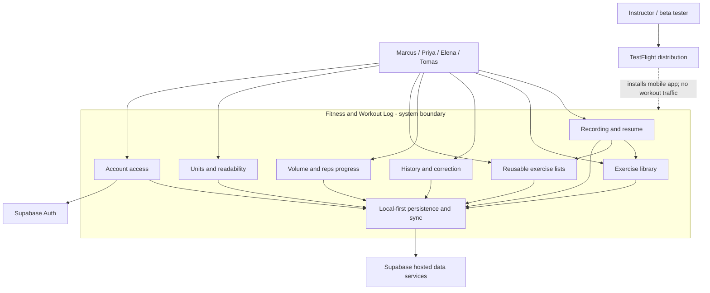

## Runtime architecture and distribution

Separates device UI/controllers, local repositories/SQLite/outbox and hosted Supabase Auth/API/PostgreSQL. EAS and TestFlight are a separate build path.

**Design value:** Explains why confirming a set is local and why the API still needs owner checks, idempotency and atomic writes.

[Edit Mermaid source](diagrams/02-architecture.mmd)

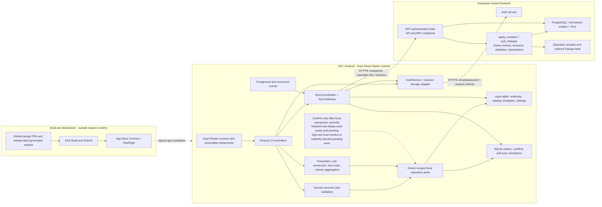

## Screen navigation

Maps launch, authentication, resume, main areas, typed entry, summary, history drill-down, templates and sync review.

**Design value:** Gives both coding models the same reachable screen flows; no story should exist only as an isolated service method.

[Edit Mermaid source](diagrams/03-navigation.mmd)

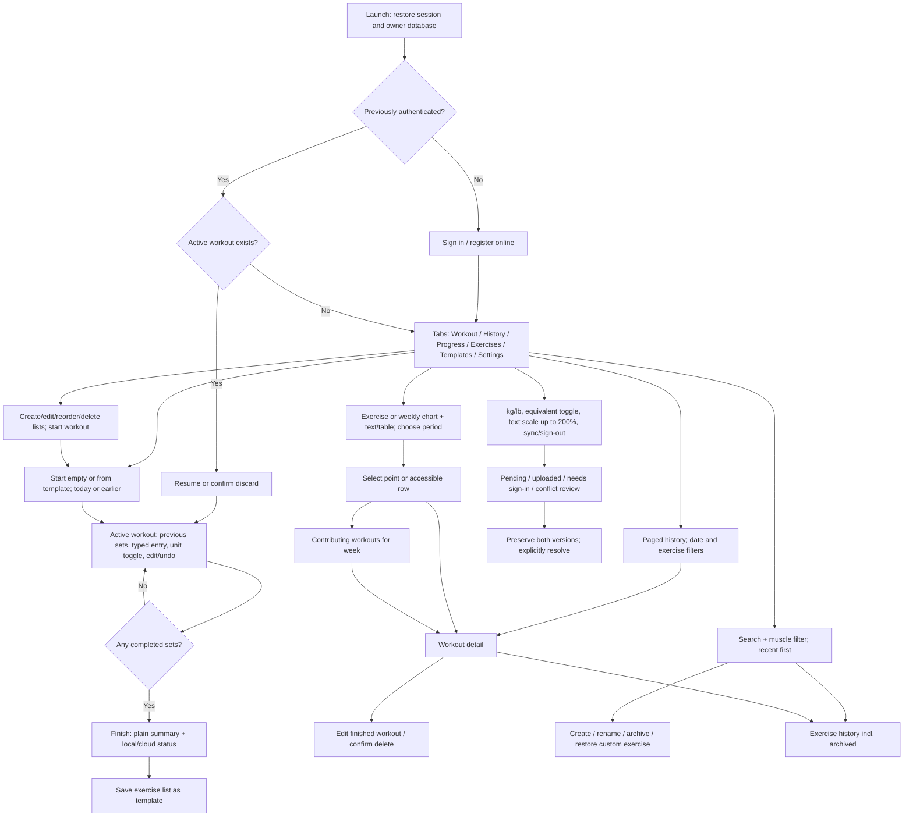

## Persistent entity relationships

Models workout/entry/set records, stable exercises, independent template lists, settings and local/server synchronization records.

**Design value:** Prevents list templates from accidentally copying sets, preserves entered units, and makes deletion/deduplication data explicit.

[Edit Mermaid source](diagrams/04-data-model.mmd)

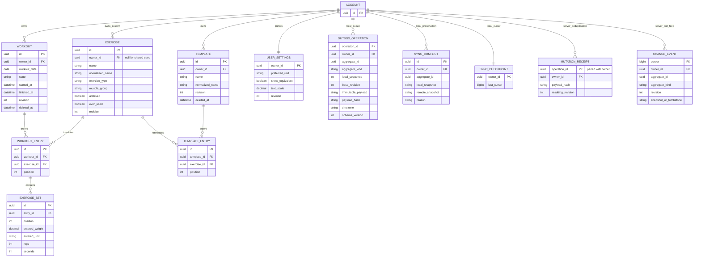

## Class model: controllers and account access

Defines each feature controller, auth gateway/session storage and bootstrap responsibilities. Routes/components delegate to these logical controllers.

**Design value:** Connects user actions to domain operations while keeping Supabase details out of screen code.

[Edit Mermaid source](diagrams/classes/01-ui-and-auth.mmd)

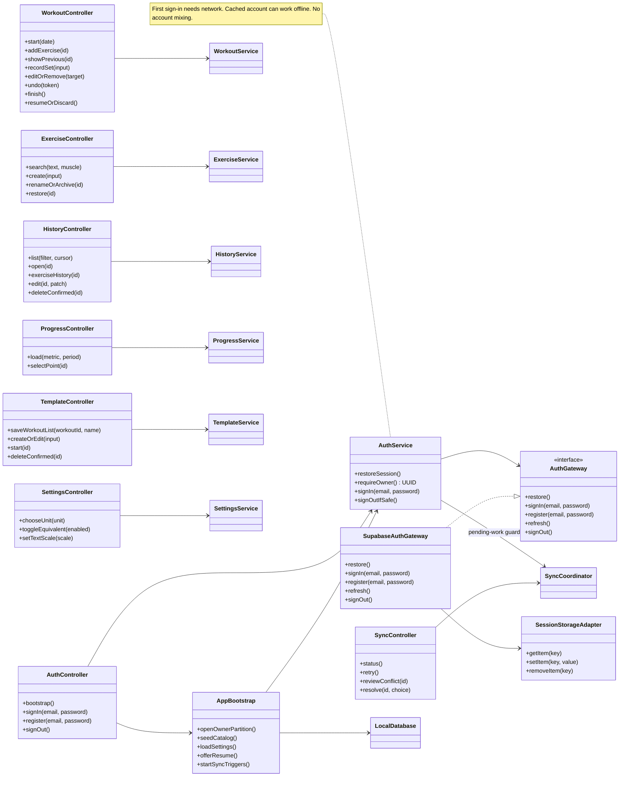

## Class model: domain entities and services

Defines typed workout records, exercise/template/settings entities, validation, service operations and enum values.

**Design value:** Makes exercise-type rules, active/finished states, stable identity and template independence implementable rather than implicit.

[Edit Mermaid source](diagrams/classes/02-domain.mmd)

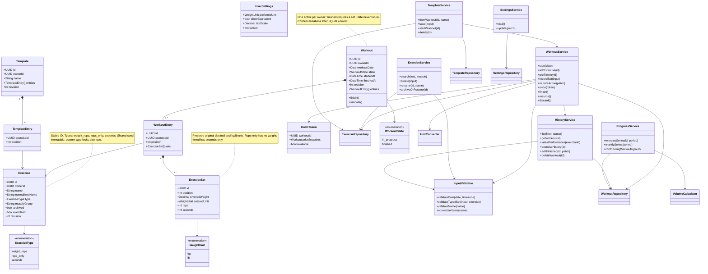

## Class model: repositories and backend handlers

Defines repository ports, SQLite adapters, transactions, sync coordination/gateway and logical PostgreSQL handlers.

**Design value:** Supplies the database-handler and API-controller responsibilities required by the assignment and supports failure recovery.

[Edit Mermaid source](diagrams/classes/03-persistence-and-sync.mmd)

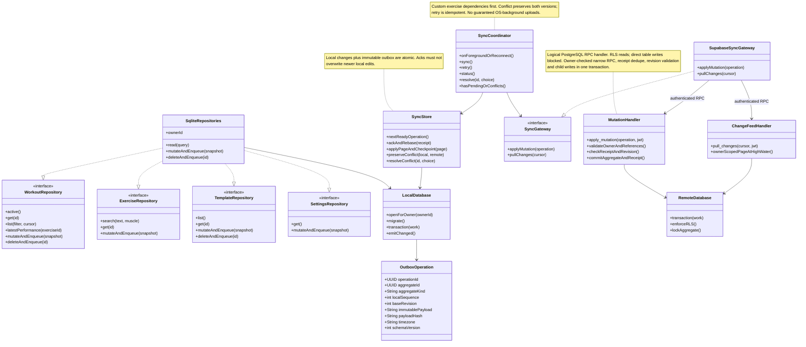

## Class model: conversion, progress and readability

Defines shared unit conversion, volume/reps aggregation, periods/points, summaries, chart tables and text-scale presentation.

**Design value:** Ensures graphs and plain summaries use the same numbers, and display conversion never corrupts originals.

[Edit Mermaid source](diagrams/classes/04-presentation.mmd)

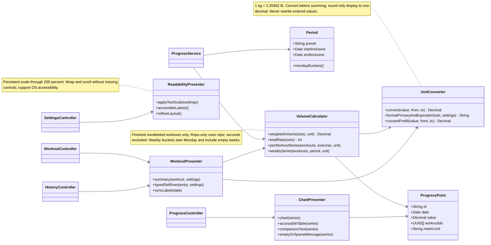

## Class model: synchronization records

Details operation snapshots, preserved conflicts, checkpoints, remote receipts and ordered change events.

**Design value:** Makes duplicate prevention, resumable pull and conflict preservation concrete types with durable fields.

[Edit Mermaid source](diagrams/classes/05-sync-records.mmd)

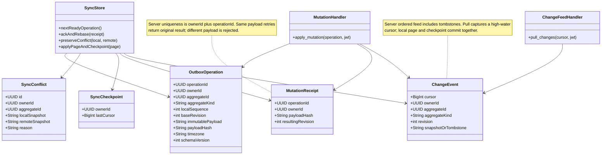

## Supporting sequence: authentication and bootstrap

Shows first online sign-in, offline reopening of a known account, owner-partition initialization and sign-out safeguards.

**Design value:** Fills the selected specification's sign-in assumption without silently mixing account data or dropping pending work.

[Edit Mermaid source](diagrams/sequence/SUP-01-auth-and-bootstrap.mmd)

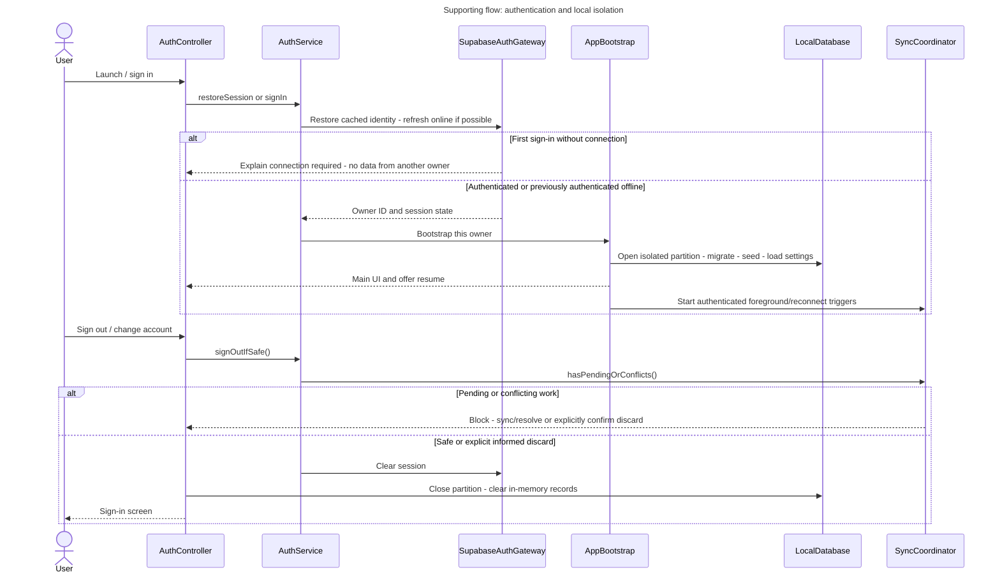

## Supporting sequence: reviewed conflict resolution

Shows presentation of preserved local/remote versions and explicit, validated resolution.

**Design value:** Resolves the source's undefined two-device-offline rule without a silent last-write-wins overwrite.

[Edit Mermaid source](diagrams/sequence/SUP-02-conflict-resolution.mmd)

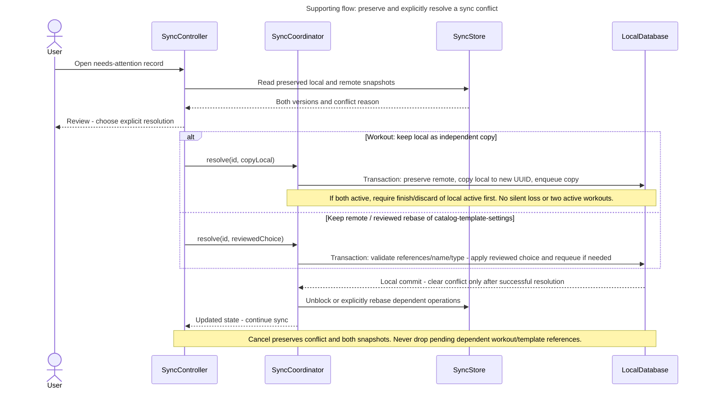

## FW-01: Start a workout, add exercises

As Marcus, I want to start a workout and add exercises as I go, so that I can log in the order I actually train. The flow identifies its UI controller, domain service and data boundary.

**Design value:** Specifies active-workout uniqueness and ordered exercise entry before logging.

[Edit Mermaid source](diagrams/sequence/FW-01.mmd)

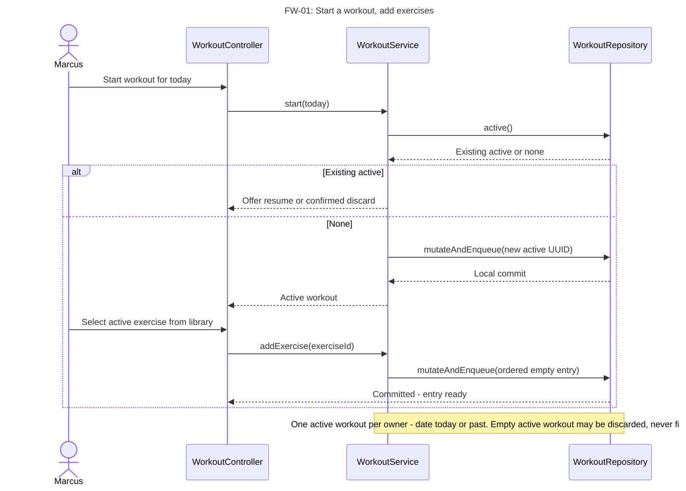

## FW-02: Record a set with prefill

As Marcus, I want to record a set by entering weight and reps, prefilled from my previous set, so that I can log between sets without losing rest time. The flow identifies its UI controller, domain service and data boundary.

**Design value:** Makes prefill precedence and durable confirmation explicit for the central recording interaction.

[Edit Mermaid source](diagrams/sequence/FW-02.mmd)

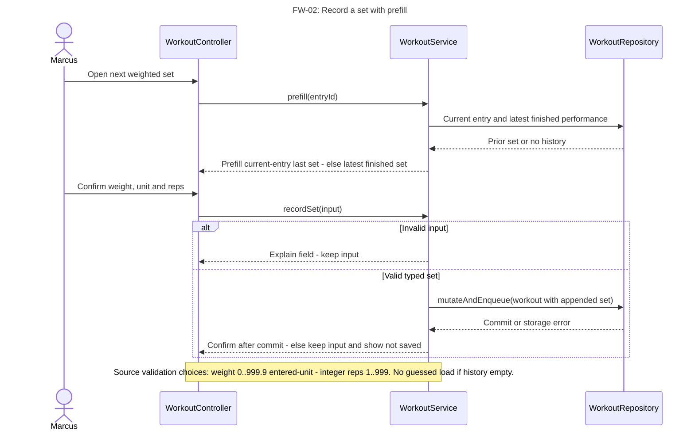

## FW-03: Set form matches exercise type

As Elena, I want the set form to ask only for what applies to the exercise, so that I am not forced to enter a weight for push-ups or planks. The flow identifies its UI controller, domain service and data boundary.

**Design value:** Prevents irrelevant weight/repetition fields from leaking into other exercise types.

[Edit Mermaid source](diagrams/sequence/FW-03.mmd)

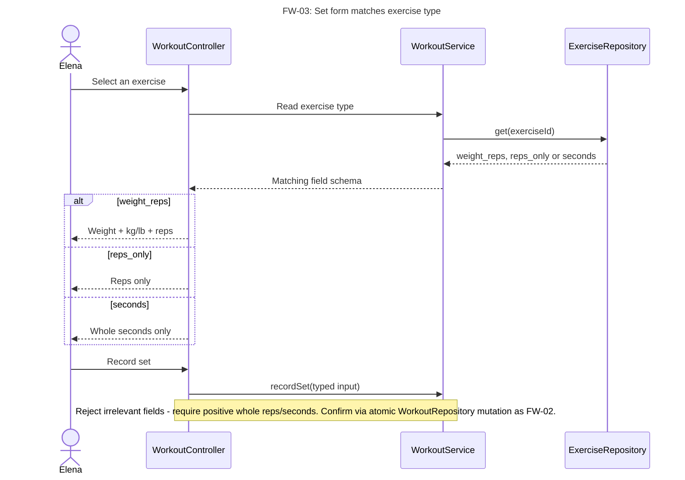

## FW-04: See previous performance

As Priya, I want to see what I did the last time I performed an exercise while I log it, so that I can choose today’s weight instead of guessing. The flow identifies its UI controller, domain service and data boundary.

**Design value:** Defines which prior session is shown and how local corrections affect it.

[Edit Mermaid source](diagrams/sequence/FW-04.mmd)

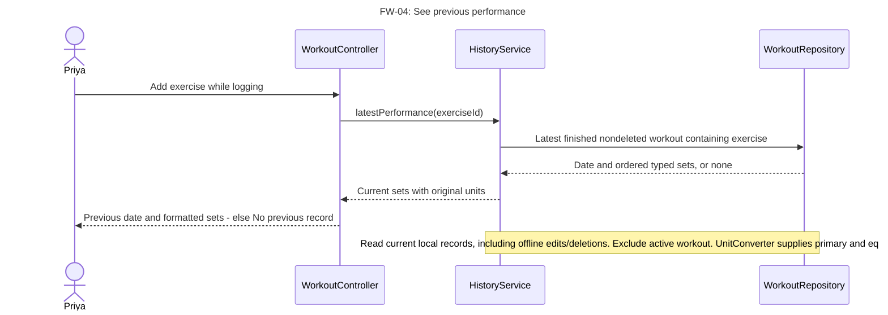

## FW-05: Correct or remove a set or entry

As Marcus, I want to correct or remove a set, or remove an entry, during a workout, so that one mistaken tap does not corrupt my history. The flow identifies its UI controller, domain service and data boundary.

**Design value:** Preserves correction, confirmation and immediate undo behavior without renumbering corruption.

[Edit Mermaid source](diagrams/sequence/FW-05.mmd)

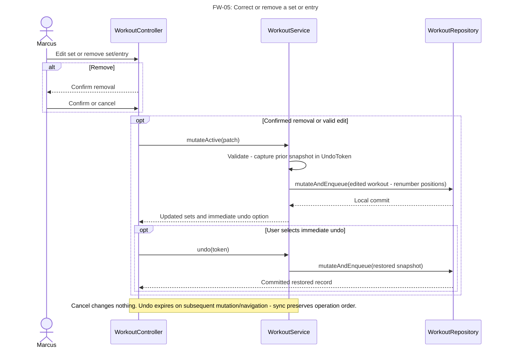

## FW-06: Finish workout, see summary

As Tomás, I want to finish a workout and see a short, plain summary, so that I know it is saved and can read what I did. The flow identifies its UI controller, domain service and data boundary.

**Design value:** Distinguishes a locally saved finish from a successfully uploaded record.

[Edit Mermaid source](diagrams/sequence/FW-06.mmd)

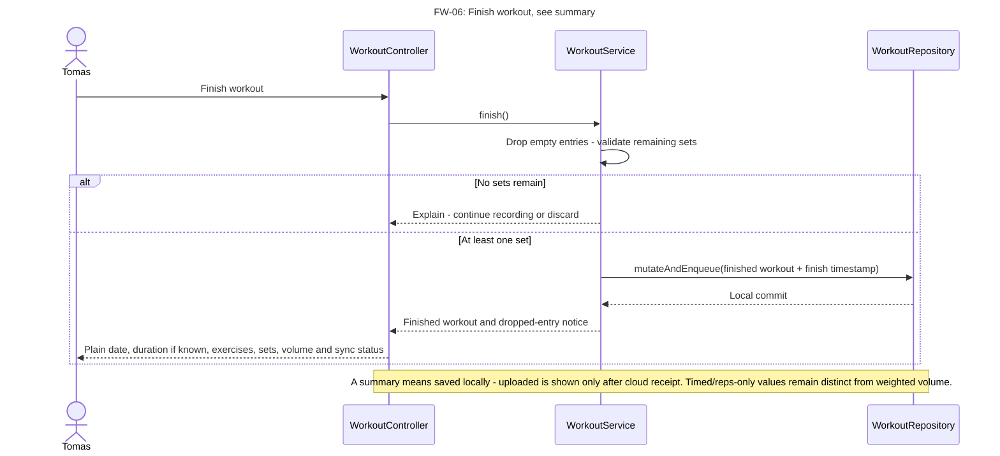

## FW-07: Resume an unfinished workout

As Priya, I want my unfinished workout to still be there if I switch apps or my phone locks, so that an interruption does not cost me the session. The flow identifies its UI controller, domain service and data boundary.

**Design value:** Requires actual process-restart persistence rather than an in-memory resume flag.

[Edit Mermaid source](diagrams/sequence/FW-07.mmd)

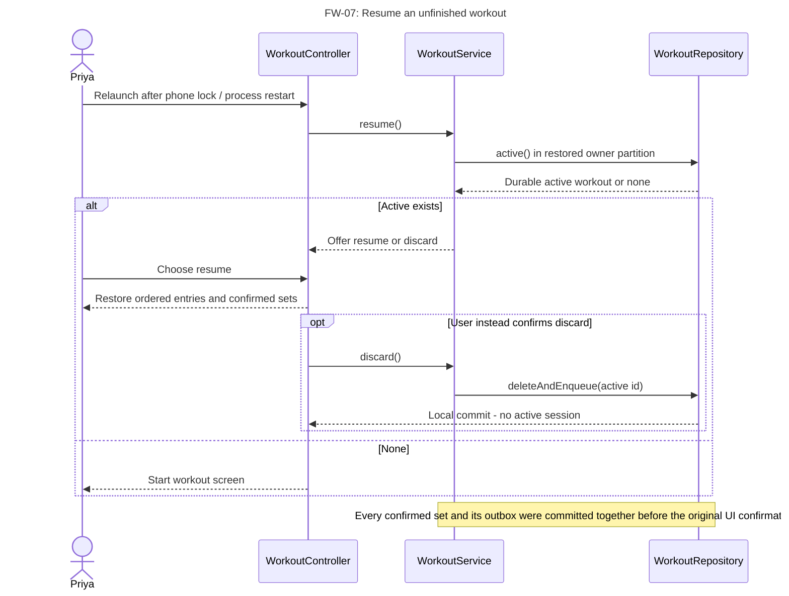

## FW-08: Record a workout on an earlier date

As Elena, I want to record a workout I already did by choosing an earlier date, so that I can catch up when I could not use my phone during the session. The flow identifies its UI controller, domain service and data boundary.

**Design value:** Separates a training calendar date from timestamps so delayed logging is graphed correctly.

[Edit Mermaid source](diagrams/sequence/FW-08.mmd)

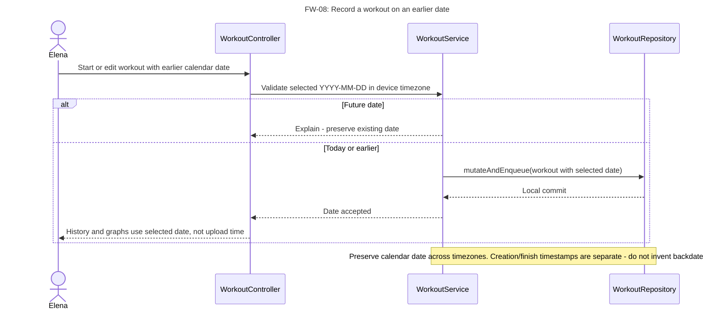

## FW-09: Log offline, upload later

As Elena, I want to log a workout when I have no connection and have it uploaded later, so that I never lose a session because of my signal. The flow identifies its UI controller, domain service and data boundary.

**Design value:** Models the highest-risk cross-system path, including retries, receipts, conflicts and pull checkpoints.

[Edit Mermaid source](diagrams/sequence/FW-09.mmd)

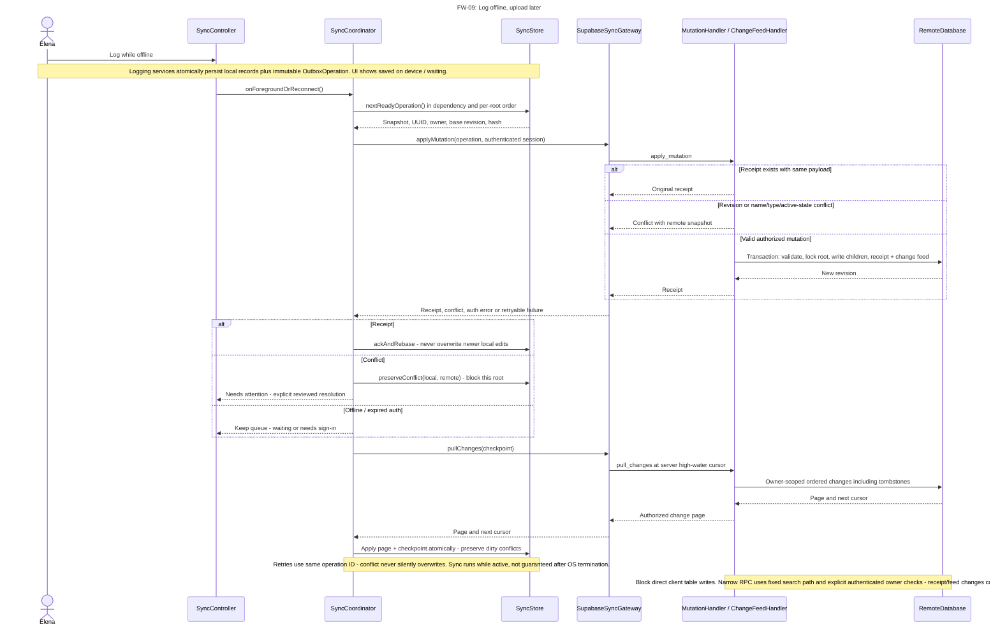

## FW-10: Choose kg or lb

As Priya, I want to choose whether weights are shown in kg or lb, so that entries match the plates and machines I use. The flow identifies its UI controller, domain service and data boundary.

**Design value:** Keeps account display preferences separate from immutable entered measurements.

[Edit Mermaid source](diagrams/sequence/FW-10.mmd)

```mermaid
sequenceDiagram
    title FW-10: Choose kg or lb
    actor U as Priya
    participant C as SettingsController
    participant S as SettingsService
    participant R as SettingsRepository
    U->>C: Choose kg or lb on first use or settings
    C->>S: update(preferredUnit)
    S->>R: mutateAndEnqueue(settings)
    R-->>S: Local commit
    S-->>C: New display preference
    C-->>U: Entry, history, summaries and graphs rerender in preferred unit
    Note over C,R: Stored set weight/unit never changes. Convert unrounded values before aggregation -  display one decimal.
```

## FW-11: Find an exercise; recent first

As Priya, I want to find an exercise by typing part of its name or filtering by muscle group, with recent ones first, so that I can add the right exercise without knowing its exact name. The flow identifies its UI controller, domain service and data boundary.

**Design value:** Makes combined search/filter and offline recent ordering consistent for both implementations.

[Edit Mermaid source](diagrams/sequence/FW-11.mmd)

```mermaid
sequenceDiagram
    title FW-11: Find an exercise -  recent first
    actor U as Priya
    participant C as ExerciseController
    participant S as ExerciseService
    participant R as ExerciseRepository
    U->>C: Type part of name and optionally select muscle group
    C->>S: search(text, muscle)
    S->>R: Search shared + own active exercises locally
    R-->>S: Case-insensitive substring plus muscle matches
    S-->>C: Results -  with empty text recent exercises first
    alt No matches
     C-->>U: No match -  offer create custom exercise
    else Matches
     C-->>U: Select exercise by stable ID
    end
    Note over S,R: Search works offline using bundled/cached catalog. Shared seed count is unspecified. Source default is up to 10 recent items first.
```

## FW-12: Create a custom exercise

As Elena, I want to create my own exercise with a name and a type, so that I can log home and unusual movements the library lacks. The flow identifies its UI controller, domain service and data boundary.

**Design value:** Specifies private custom exercise creation, name conflicts and eventual type locking.

[Edit Mermaid source](diagrams/sequence/FW-12.mmd)

```mermaid
sequenceDiagram
    title FW-12: Create a custom exercise
    actor U as Elena
    participant C as ExerciseController
    participant S as ExerciseService
    participant R as ExerciseRepository
    U->>C: Name, type and muscle group for custom exercise
    C->>S: create(input)
    S->>S: Validate name -  normalize case and whitespace
    S->>R: Check name against shared and own custom catalog
    alt Duplicate or invalid
     S-->>C: Explain and retain form
    else Unique
     S->>R: mutateAndEnqueue(new owned exercise UUID)
     R-->>S: Local commit
     S-->>C: Exercise available offline
    end
    Note over S,R: Nonempty name up to source-proposed 60 chars. Type becomes immutable after any set references it. Sync uploads exercise before dependent workout/template.
```

## FW-13: Rename or archive a custom exercise

As Marcus, I want to rename or archive a custom exercise, so that I can tidy my library without losing history. The flow identifies its UI controller, domain service and data boundary.

**Design value:** Keeps rename/archive changes attached to stable exercise identities and historical sets.

[Edit Mermaid source](diagrams/sequence/FW-13.mmd)

```mermaid
sequenceDiagram
    title FW-13: Rename or archive a custom exercise
    actor U as Marcus
    participant C as ExerciseController
    participant S as ExerciseService
    participant R as ExerciseRepository
    U->>C: Rename, archive or restore custom exercise
    C->>S: rename / archiveOrRestore(id)
    S->>R: Read owner and shared/custom state
    alt Shared exercise or name invalid/duplicate
     S-->>C: Reject -  preserve existing exercise
    else Own custom exercise
     S->>R: mutateAndEnqueue(same ID, changed name/archive flag)
     R-->>S: Local commit
     S-->>C: Search refreshed -  history and graphs resolve current name
    end
    Note over S,R: Archive hides picker entry but preserves sets and template references. Restore is available. Used exercises cannot be deleted or change type.
```

## FW-14: List finished workouts

As Tomás, I want to see a list of my finished workouts with dates, exercises and number of sets, so that I can quickly check when and what I trained. The flow identifies its UI controller, domain service and data boundary.

**Design value:** Defines an accessible paged list with stable ordering and an honest empty state.

[Edit Mermaid source](diagrams/sequence/FW-14.mmd)

```mermaid
sequenceDiagram
    title FW-14: List finished workouts
    actor U as Tomas
    participant C as HistoryController
    participant S as HistoryService
    participant R as WorkoutRepository
    U->>C: Open history / scroll for older rows
    C->>S: list(filter, cursor)
    S->>R: Finished nondeleted workouts ordered date DESC, ID DESC
    R-->>S: Page and stable next cursor
    S-->>C: Date, first three exercise names, and N more, set count
    alt Empty history
     C-->>U: Explain how to log first workout
    else Rows exist
     C-->>U: Readable dated list using saved text scale
    end
    Note over C,R: Include locally finished pending uploads. Pagination uses date plus ID -  source three-name row layout is a display rule, not a capacity promise.
```

## FW-15: Open a past workout

As Marcus, I want to open a past workout and see every exercise and set as recorded, so that I can plan a repeat or check what I did. The flow identifies its UI controller, domain service and data boundary.

**Design value:** Provides complete, current records without forcing users through graphs.

[Edit Mermaid source](diagrams/sequence/FW-15.mmd)

```mermaid
sequenceDiagram
    title FW-15: Open a past workout
    actor U as Marcus
    participant C as HistoryController
    participant S as HistoryService
    participant R as WorkoutRepository
    U->>C: Open past workout ID
    C->>S: getWorkout(id)
    S->>R: Owner-scoped finished nondeleted workout with entries/sets
    alt Not found or deleted
     R-->>C: Explain and return to list
    else Found
     R-->>S: Current snapshot
     S-->>C: Ordered exercises and typed sets
     C-->>U: Date, duration if known, total volume, units and plain summary
    end
    Note over C,S: WorkoutPresenter uses current unit/text preferences -  original weights remain intact. Unsynced edits are visible immediately.
```

## FW-16: History of one exercise

As Marcus, I want to see every time I performed one exercise, with the sets from each session, so that I can follow one lift in numbers. The flow identifies its UI controller, domain service and data boundary.

**Design value:** Makes exercise-level history reachable and robust to renaming/archiving.

[Edit Mermaid source](diagrams/sequence/FW-16.mmd)

```mermaid
sequenceDiagram
    title FW-16: History of one exercise
    actor U as Marcus
    participant C as HistoryController
    participant S as HistoryService
    participant R as WorkoutRepository
    U->>C: Open exercise history from library or workout entry
    C->>S: exerciseHistory(stable exerciseId)
    S->>R: Finished workouts containing exercise, newest first
    R-->>S: Dates and matching typed sets
    S-->>C: Exercise-specific history or empty result
    C-->>U: Readable values in preferred units with equivalents if enabled
    Note over S,R: Archived exercise remains readable. Renaming keeps the same ID -  edits and deletion change this query immediately.
```

## FW-17: Edit a finished workout

As Elena, I want to edit a finished workout, so that I can fix mistakes I notice later. The flow identifies its UI controller, domain service and data boundary.

**Design value:** Carries all original validation rules into finished-record correction and derived views.

[Edit Mermaid source](diagrams/sequence/FW-17.mmd)

```mermaid
sequenceDiagram
    title FW-17: Edit a finished workout
    actor U as Elena
    participant C as HistoryController
    participant S as HistoryService
    participant R as WorkoutRepository
    U->>C: Edit finished workout date / entries / sets
    C->>S: editFinished(id, patch)
    S->>S: Apply typed-set rules, nonfuture date, at least one set
    alt Invalid or empty result
     S-->>C: Explain -  keep saved version and editor input
    else Valid
     S->>R: mutateAndEnqueue(updated full snapshot)
     R-->>S: Local commit
     S-->>C: Updated summary
     C-->>U: History, previous performance and graphs reflect edit
    end
    Note over S,R: Works offline -  local data event invalidates derived views. Later upload uses expected revision, with explicit conflict if remote changed.
```

## FW-18: Delete a finished workout

As Elena, I want to delete a finished workout after confirming, so that accidental or test entries do not distort my history and graphs. The flow identifies its UI controller, domain service and data boundary.

**Design value:** Explains both user-visible permanent deletion and internal synchronization tombstones.

[Edit Mermaid source](diagrams/sequence/FW-18.mmd)

```mermaid
sequenceDiagram
    title FW-18: Delete a finished workout
    actor U as Elena
    participant C as HistoryController
    participant S as HistoryService
    participant R as WorkoutRepository
    U->>C: Delete finished workout
    C-->>U: Confirm workout date and set count
    alt Cancel
     C-->>U: Keep workout unchanged
    else Confirm
     C->>S: deleteWorkout(id)
     S->>R: deleteAndEnqueue(tombstone)
     R-->>S: Local commit
     S-->>C: Deleted locally -  upload pending if offline
     C-->>U: Remove from history, previous performance and all graphs
    end
    Note over S,R: No user-facing recycle bin. Keep sync tombstone so cloud deletion propagates and cannot be resurrected by a stale pull.
```

## FW-19: Filter history

As Priya, I want to narrow my history to a date range or to one exercise, so that I can find a specific period or lift without scrolling. The flow identifies its UI controller, domain service and data boundary.

**Design value:** Prevents date and exercise filters from accidentally replacing each other.

[Edit Mermaid source](diagrams/sequence/FW-19.mmd)

```mermaid
sequenceDiagram
    title FW-19: Filter history
    actor U as Priya
    participant C as HistoryController
    participant S as HistoryService
    participant R as WorkoutRepository
    U->>C: Select date range and/or exercise
    C->>S: list(combined filter, reset cursor)
    alt Reversed or invalid date range
     S-->>C: Explain -  do not issue invalid query
    else Valid
     S->>R: Finished workouts matching both optional filters
     R-->>S: Paged rows or none
     S-->>C: Results or no-matches message
    end
    U->>C: Clear filters
    C->>S: list(empty filter, reset cursor)
    Note over C,R: Exercise comparison uses stable ID. Dates inclusive. Filters compose, not replace each other.
```

## FW-20: Per-exercise volume graph

As Marcus, I want to see a graph of my total volume for one exercise over time, so that I can tell whether I am lifting more than before. The flow identifies its UI controller, domain service and data boundary.

**Design value:** Ties exercise chart points directly to converted source sets and workout IDs.

[Edit Mermaid source](diagrams/sequence/FW-20.mmd)

```mermaid
sequenceDiagram
    title FW-20: Per-exercise volume graph
    actor U as Marcus
    participant C as ProgressController
    participant S as ProgressService
    participant R as WorkoutRepository
    participant V as VolumeCalculator
    U->>C: Open weighted exercise graph
    C->>S: exerciseSeries(exerciseId, period)
    S->>R: Current finished workouts and matching weighted sets
    R-->>S: Entered weights, units, reps and dates
    S->>V: Convert unrounded weights -  sum weight times reps per workout
    V-->>S: Points with workout IDs and metric unit
    S-->>C: Series and source references
    C-->>U: Dated unit-labelled chart + accessible table + explanation
    Note over C,V: Fewer than two workouts shows sparse-data message. Do not infer strength or health. Timed exercises have no graph.
```

## FW-21: Choose the period

As Marcus, I want to choose the period shown on a graph, so that I can compare recent weeks with the longer trend. The flow identifies its UI controller, domain service and data boundary.

**Design value:** Keeps chart, table and explanation synchronized when period controls change.

[Edit Mermaid source](diagrams/sequence/FW-21.mmd)

```mermaid
sequenceDiagram
    title FW-21: Choose the period
    actor U as Marcus
    participant C as ProgressController
    participant S as ProgressService
    participant R as WorkoutRepository
    participant V as VolumeCalculator
    U->>C: Choose 4 weeks, 12 weeks, 1 year or all time
    C->>S: Recompute current metric for selected Period
    S->>R: Filter by saved workout date, inclusive endpoints
    R-->>S: Matching current workouts
    S->>V: Reaggregate metric and weekly zero buckets if applicable
    V-->>S: New series and text-summary values
    S-->>C: Replace chart, accessible table and summary together
    Note over C,S: All-time begins at earliest finished workout. Empty account shows empty state. Date choice applies to every graph type.
```

## FW-22: Overall weekly volume graph

As Priya, I want to see my total volume per week across all weight-based exercises, so that I can tell whether I am training more overall. The flow identifies its UI controller, domain service and data boundary.

**Design value:** Defines weekly bucketing, zero weeks and the zero-denominator comparison case.

[Edit Mermaid source](diagrams/sequence/FW-22.mmd)

```mermaid
sequenceDiagram
    title FW-22: Overall weekly volume graph
    actor U as Priya
    participant C as ProgressController
    participant S as ProgressService
    participant R as WorkoutRepository
    participant V as VolumeCalculator
    U->>C: Open overall weekly volume
    C->>S: weeklySeries(period)
    S->>R: Finished weighted sets in date range
    R-->>S: Records and dates
    S->>V: Convert to preferred unit -  sum weight times reps by Monday-start week
    V-->>S: Weekly points including zero weeks and source workout IDs
    S-->>C: Points and latest-two-week comparison values
    C-->>U: Chart + table + plain sentence -  label partial weeks
    Note over C,V: Reps-only and timed sets excluded. Previous week zero uses absolute difference, never division by zero.
```

## FW-23: Reps-only total reps graph

As Elena, I want to see my total reps per workout for a reps-only exercise, so that I can follow progress on bodyweight exercises. The flow identifies its UI controller, domain service and data boundary.

**Design value:** Avoids assigning weighted volume or kilograms to reps-only exercises.

[Edit Mermaid source](diagrams/sequence/FW-23.mmd)

```mermaid
sequenceDiagram
    title FW-23: Reps-only total reps graph
    actor U as Elena
    participant C as ProgressController
    participant S as ProgressService
    participant R as WorkoutRepository
    participant V as VolumeCalculator
    U->>C: Open reps-only exercise progress
    C->>S: exerciseSeries(exerciseId, period)
    S->>R: Finished matching reps-only sets
    R-->>S: Date, workout ID and reps
    S->>V: Sum reps per workout
    V-->>S: Reps series
    S-->>C: Points with metric Total reps
    C-->>U: Chart + accessible table and empty/sparse explanation
    Note over C,V: Do not convert reps into weighted volume. Seconds-based exercises are recorded but not graphed.
```

## FW-24: Select a point, open workout

As Marcus, I want to select a point on a graph to see its date and value and open that workout, so that I can understand an unusually high or low session. The flow identifies its UI controller, domain service and data boundary.

**Design value:** Preserves the link from a chart/table point to the actual contributing records.

[Edit Mermaid source](diagrams/sequence/FW-24.mmd)

```mermaid
sequenceDiagram
    title FW-24: Select a point, open workout
    actor U as Marcus
    participant C as ProgressController
    participant S as ProgressService
    participant R as WorkoutRepository
    U->>C: Select chart point or equivalent table row
    C->>S: contributingWorkouts(pointId)
    S->>R: Resolve current nondeleted workout IDs behind point
    R-->>S: Contributing records
    S-->>C: Date/value and source records
    alt Exercise point
     C-->>U: Open workout detail
    else Weekly point with workouts
     C-->>U: List contributing workouts -  choose one to open
    else Empty week / removed source
     C-->>U: Explain no contributing workout -  refresh series
    end
    Note over C,S: Accessible table selection supports same drill-down. Do not route by displayed date alone.
```

## FW-25: Save workout as template

As Elena, I want to save the exercises of a finished workout as a named template, so that I can start my usual routine again without re-entering it. The flow identifies its UI controller, domain service and data boundary.

**Design value:** Makes templates independent exercise lists rather than copies of performed sets.

[Edit Mermaid source](diagrams/sequence/FW-25.mmd)

```mermaid
sequenceDiagram
    title FW-25: Save workout as template
    actor U as Elena
    participant C as TemplateController
    participant S as TemplateService
    participant R as TemplateRepository
    participant W as HistoryService
    U->>C: Save finished workout as named template
    C->>S: fromWorkout(workoutId, name)
    S->>W: getWorkout(workoutId)
    W-->>S: Ordered finished workout entries
    S->>R: Check normalized template name uniqueness
    alt Invalid or duplicate name
     S-->>C: Explain -  preserve name input
    else Valid
     S->>R: mutateAndEnqueue(new template with ordered exercise IDs only)
     R-->>S: Local commit
     S-->>C: Template saved, upload pending if offline
    end
    Note over S,R: Nonempty name up to source-proposed 60 chars. No sets, weights or reps copied -  source workout remains independent.
```

## FW-26: Start workout from template

As Marcus, I want to start a workout from a template, so that its exercises are already in the workout when I begin. The flow identifies its UI controller, domain service and data boundary.

**Design value:** Defines archived exercise handling and avoids copying prescribed loads into a workout.

[Edit Mermaid source](diagrams/sequence/FW-26.mmd)

```mermaid
sequenceDiagram
    title FW-26: Start workout from template
    actor U as Marcus
    participant C as TemplateController
    participant S as TemplateService
    participant R as TemplateRepository
    participant W as WorkoutService
    U->>C: Start workout from template
    C->>S: startWorkout(templateId)
    S->>R: get(templateId) and resolve exercises
    R-->>S: Ordered IDs with archive flags
    S-->>C: Mark archived exercises and offer skip
    U->>C: Confirm selection
    S->>W: start(today) -  add selected active exercises in order
    W-->>S: New active workout committed via local transaction/outbox
    S-->>C: Empty typed entries -  previous performance available
    Note over C,S: Template unchanged. Existing active workout triggers resume/discard. No load/reps prescription copied from template.
```

## FW-27: Create and edit a template

As Priya, I want to create and edit a template by choosing exercises myself, so that I can set up my plan at home before going to the gym. The flow identifies its UI controller, domain service and data boundary.

**Design value:** Captures name validation, ordering and independent template edits.

[Edit Mermaid source](diagrams/sequence/FW-27.mmd)

```mermaid
sequenceDiagram
    title FW-27: Create and edit a template
    actor U as Priya
    participant C as TemplateController
    participant S as TemplateService
    participant R as TemplateRepository
    U->>C: Create or edit named template
    C-->>U: Search exercise library, add, reorder, remove
    U->>C: Save ordered list
    C->>S: save(name, ordered exerciseIds)
    S->>S: Validate name, unique per owner, nonempty exercise list
    S->>R: mutateAndEnqueue(template snapshot)
    R-->>S: Local commit or validation/storage failure
    S-->>C: Saved after commit -  else explain and keep editor
    Note over C,R: Renaming/reordering changes this template only, not previous workouts. Archived references stay marked -  new selections must be active.
```

## FW-28: Delete a template

As Marcus, I want to delete a template, so that I can retire routines I no longer use. The flow identifies its UI controller, domain service and data boundary.

**Design value:** Ensures deleting a saved routine never deletes workouts started from it.

[Edit Mermaid source](diagrams/sequence/FW-28.mmd)

```mermaid
sequenceDiagram
    title FW-28: Delete a template
    actor U as Marcus
    participant C as TemplateController
    participant S as TemplateService
    participant R as TemplateRepository
    U->>C: Delete a saved template
    C-->>U: Confirmation with template name
    alt Cancel
     C-->>U: Template unchanged
    else Confirm
     C->>S: delete(templateId)
     S->>R: deleteAndEnqueue(template tombstone)
     R-->>S: Local commit
     S-->>C: Template removed from list
    end
    Note over S,R: Existing active and finished workouts are independent and unchanged. Tombstone uploads through the same durable queue.
```

## FW-29: Larger text size

As Tomás, I want to make the text larger, so that I can read my workouts and summaries without straining. The flow identifies its UI controller, domain service and data boundary.

**Design value:** Makes large text a persistent app-wide presentation behavior.

[Edit Mermaid source](diagrams/sequence/FW-29.mmd)

```mermaid
sequenceDiagram
    title FW-29: Larger text size
    actor U as Tomas
    participant C as SettingsController
    participant S as SettingsService
    participant R as SettingsRepository
    participant P as ReadabilityPresenter
    U->>C: Choose larger text up to 200 percent
    C->>S: update(textScale)
    S->>R: mutateAndEnqueue(settings)
    R-->>S: Local commit
    S-->>C: Persistent preference
    C->>P: applyTextScale and reflowLayout
    P-->>U: Readable entry, history, summary, template and settings controls
    Note over C,P: Wrap/scroll without losing content. Provide plain labels, screen-reader labels and text/table chart alternatives. Restore preference at launch.
```

## FW-30: See both units

As Tomás, I want to see each weight with its equivalent in the other unit, so that I know how much to load when a gym’s plates use a different unit. The flow identifies its UI controller, domain service and data boundary.

**Design value:** Uses one conversion/formatting path for every equivalent weight display.

[Edit Mermaid source](diagrams/sequence/FW-30.mmd)

```mermaid
sequenceDiagram
    title FW-30: See both units
    actor U as Tomas
    participant C as SettingsController
    participant S as SettingsService
    participant R as SettingsRepository
    participant P as UnitConverter
    U->>C: Enable or disable equivalent weight display
    C->>S: update(showEquivalent)
    S->>R: mutateAndEnqueue(settings)
    R-->>S: Local commit
    S-->>C: Updated presentation preference
    C->>P: formatPrimaryAndEquivalent(set, settings)
    P-->>U: For example 60 kg (132.3 lb), or primary value only
    Note over C,P: Weighted set rows, previous performance and summaries use same formatter. Factor 2.20462 -  display one decimal -  no stored value changes.
```

## FW-31: Enter a set in either unit

As Tomás, I want to enter a set in either kg or lb, so that I can log what the plates say without converting. The flow identifies its UI controller, domain service and data boundary.

**Design value:** Prevents a unit switch from silently reinterpreting a number without conversion.

[Edit Mermaid source](diagrams/sequence/FW-31.mmd)

```mermaid
sequenceDiagram
    title FW-31: Enter a set in either unit
    actor U as Tomas
    participant C as WorkoutController
    participant S as WorkoutService
    participant R as WorkoutRepository
    participant P as UnitConverter
    U->>C: Open weighted-set form
    C-->>U: Unit defaults to preferred account unit
    U->>C: Choose kg or lb and enter value
    opt Switch unit after entering a value
     C->>P: convertPrefill(value, old unit, new unit)
     P-->>C: Converted value -  explicit confirmation, no silent relabel
    end
    C->>S: recordSet(enteredWeight, enteredUnit, reps)
    S->>S: Validate bounds in entered unit and typed fields
    S->>R: mutateAndEnqueue(set with original decimal and unit)
    R-->>S: Local commit
    S-->>C: Confirm set
    C-->>U: Preferred-unit value plus optional equivalent
    Note over S,R: Prefill converts when source unit differs. History/graphs convert at read time. Switching display preference never rewrites originals.
```
