# Fitness & Workout Log - Mermaid design guide

**Planned training design, November 8, 2026.** The original 31 FW stories and point estimates are retained for traceability. The [training draft](TRAINING_REQUIREMENTS_DRAFT.md) adds TR-01–13 and supersedes conflicting behavior in the original scope. See the [interface requirements](ROUND_02_UI.md) for the dark theme.
See [the requirements alignment review](REVISED_REPORT_REVIEW.md) and [source report](source/Fitness_Workout_Log_App_Revised_v2.docx).
Proposed stack: Expo / React Native, local SQLite and Supabase. Intended iOS
distribution: TestFlight. This is design, not generated implementation evidence.

Review [scope](SCOPE.md), [contracts](CONTRACTS.md) and
[story coverage](TRACEABILITY.md) alongside these diagrams.

## Reading order

Start with context and architecture, then navigation/data, the five class-model
sheets and the story sequences. The two supporting sequences explain account
bootstrap and conflict resolution. Class sheets form one modular class model;
repeated names mean the same logical type. Every diagram has a description and
justification below. The index includes 5 top-level diagrams, 5 class sheets,
31 original story sequences, 2 supporting sequences and 7 planned training sequences.

The `.mmd` sources are authoritative. Run `python3 scripts/check_design.py --sync`
after editing them to update the mirrored Mermaid blocks below, then render.
GitHub can preview these blocks. Local SVG output is generated under `rendered/`
and ignored by Git; retain source/PR history as assignment evidence.

## Review before generation

- All 31 story paragraphs and details match the revised report; retain its roles and functional ownership rules.
- Review conflict handling, Monday weeks, offline account access and archive rules.
- Review screen flow and large-text behavior with both teammates.
- Confirm Apple Developer access and the instructor's acceptance of TestFlight.
- Initial PRs #2–#45 are merged; record the final baseline commit before invoking either coding model.

The next generation is on hold. See the [experiment log](../experiments/RUN_LOG.md)
for implementation history and the [experiment protocol](../experiments/README.md)
for the process before another run.

## Diagram contents

- [Context and functional modules](diagrams/01-context.mmd)
- [Runtime architecture and distribution](diagrams/02-architecture.mmd)
- [Screen navigation](diagrams/03-navigation.mmd)
- [Persistent entity relationships](diagrams/04-data-model.mmd)
- [Persistent entity relationships for profile, catalog and device state](diagrams/05-training-data.mmd)
- [Class model: controllers and account access](diagrams/classes/01-ui-and-auth.mmd)
- [Class model: domain entities and services](diagrams/classes/02-domain.mmd)
- [Class model: repositories and backend handlers](diagrams/classes/03-persistence-and-sync.mmd)
- [Class model: conversion, progress and readability](diagrams/classes/04-presentation.mmd)
- [Class model: synchronization records](diagrams/classes/05-sync-records.mmd)
- [Supporting sequence: authentication and bootstrap](diagrams/sequence/SUP-01-auth-and-bootstrap.mmd)
- [Supporting sequence: reviewed conflict resolution](diagrams/sequence/SUP-02-conflict-resolution.mmd)
- [FW-01: Start a workout, add exercises](diagrams/sequence/FW-01.mmd)
- [FW-02: Record a set with prefill](diagrams/sequence/FW-02.mmd)
- [FW-03: Set form matches exercise type](diagrams/sequence/FW-03.mmd)
- [FW-04: See previous performance](diagrams/sequence/FW-04.mmd)
- [FW-05: Correct or remove a set or entry](diagrams/sequence/FW-05.mmd)
- [FW-06: Finish workout, see summary](diagrams/sequence/FW-06.mmd)
- [FW-07: Resume an unfinished workout](diagrams/sequence/FW-07.mmd)
- [FW-08: Record a workout on an earlier date](diagrams/sequence/FW-08.mmd)
- [FW-09: Log offline, upload later](diagrams/sequence/FW-09.mmd)
- [FW-10: Choose kg or lb](diagrams/sequence/FW-10.mmd)
- [FW-11: Find an exercise; recent first](diagrams/sequence/FW-11.mmd)
- [FW-12: Create a custom exercise](diagrams/sequence/FW-12.mmd)
- [FW-13: Rename or archive a custom exercise](diagrams/sequence/FW-13.mmd)
- [FW-14: List finished workouts](diagrams/sequence/FW-14.mmd)
- [FW-15: Open a past workout](diagrams/sequence/FW-15.mmd)
- [FW-16: History of one exercise](diagrams/sequence/FW-16.mmd)
- [FW-17: Edit a finished workout](diagrams/sequence/FW-17.mmd)
- [FW-18: Delete a finished workout](diagrams/sequence/FW-18.mmd)
- [FW-19: Filter history](diagrams/sequence/FW-19.mmd)
- [FW-20: Per-exercise volume graph](diagrams/sequence/FW-20.mmd)
- [FW-21: Choose the period](diagrams/sequence/FW-21.mmd)
- [FW-22: Overall weekly volume graph](diagrams/sequence/FW-22.mmd)
- [FW-23: Reps-only total reps graph](diagrams/sequence/FW-23.mmd)
- [FW-24: Select a point, open workout](diagrams/sequence/FW-24.mmd)
- [FW-25: Save workout as template](diagrams/sequence/FW-25.mmd)
- [FW-26: Start workout from template](diagrams/sequence/FW-26.mmd)
- [FW-27: Create and edit a template](diagrams/sequence/FW-27.mmd)
- [FW-28: Delete a template](diagrams/sequence/FW-28.mmd)
- [FW-29: Larger text size](diagrams/sequence/FW-29.mmd)
- [FW-30: See both units](diagrams/sequence/FW-30.mmd)
- [FW-31: Enter a set in either unit](diagrams/sequence/FW-31.mmd)
- [TR-01 / TR-02: Plan a routine and complete working sets](diagrams/sequence/TR-01-02-planned-training.mmd)
- [TR-03 / TR-13: Rest countdown and iOS Lock Screen](diagrams/sequence/TR-03-13-rest-and-live-activity.mmd)
- [TR-04 / TR-05: Warm-up and targeted mobility](diagrams/sequence/TR-04-05-preparation.mmd)
- [TR-06 / TR-07: Offline catalog and profile muscle map](diagrams/sequence/TR-06-07-catalog-and-muscles.mmd)
- [TR-08 / TR-09 / TR-11: Reports, lift goals and optional bodyweight](diagrams/sequence/TR-08-09-11-profile-progress.mmd)
- [TR-10: Export my data](diagrams/sequence/TR-10-export.mmd)
- [TR-12: Opt-in workout reminders](diagrams/sequence/TR-12-reminders.mmd)

## Context and functional modules

Shows lifter roles, planned training, profile insights, device alerts, export and the hosted account and sync boundaries.

**Design value:** Makes product responsibilities explicit without confusing TestFlight with a runtime workout service.

[Edit Mermaid source](diagrams/01-context.mmd)

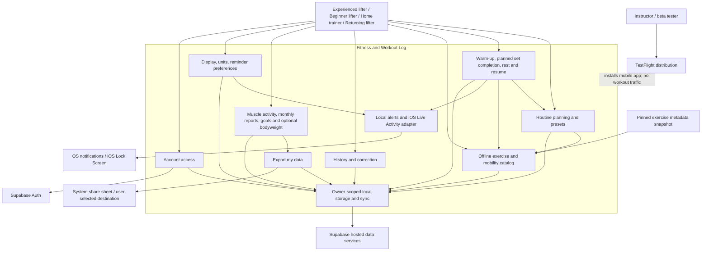

## Runtime architecture and distribution

Connects local records and the sync outbox to Supabase, with separate device timers, ActivityKit and the system share sheet.

**Design value:** Explains why confirming a set is local and why the API still needs owner checks, idempotency and atomic writes.

[Edit Mermaid source](diagrams/02-architecture.mmd)

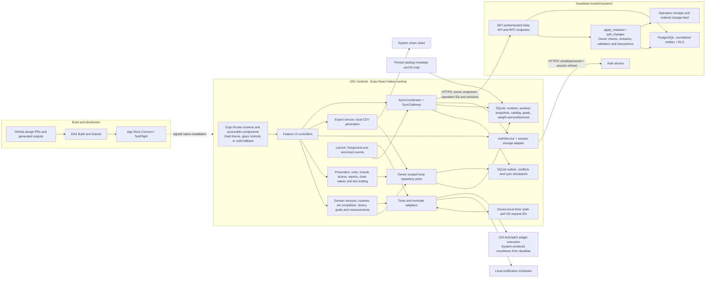

## Screen navigation

Maps routine planning, preparation, set completion, rest, profile insights, export and reminder entry points.

**Design value:** Gives both coding models the same reachable screen flows; no story should exist only as an isolated service method.

[Edit Mermaid source](diagrams/03-navigation.mmd)

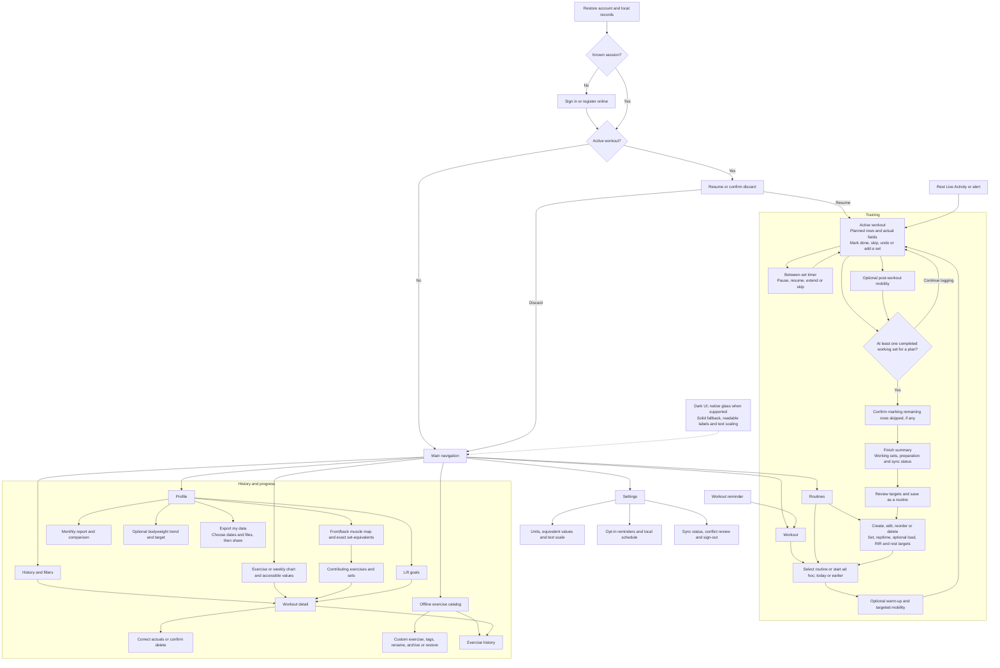

## Persistent entity relationships

Models routine prescriptions and independent workout snapshots with typed actuals, set states and existing synchronization records.

**Design value:** Keeps prescribed values separate from confirmed results and preserves historical records when routines change.

[Edit Mermaid source](diagrams/04-data-model.mmd)

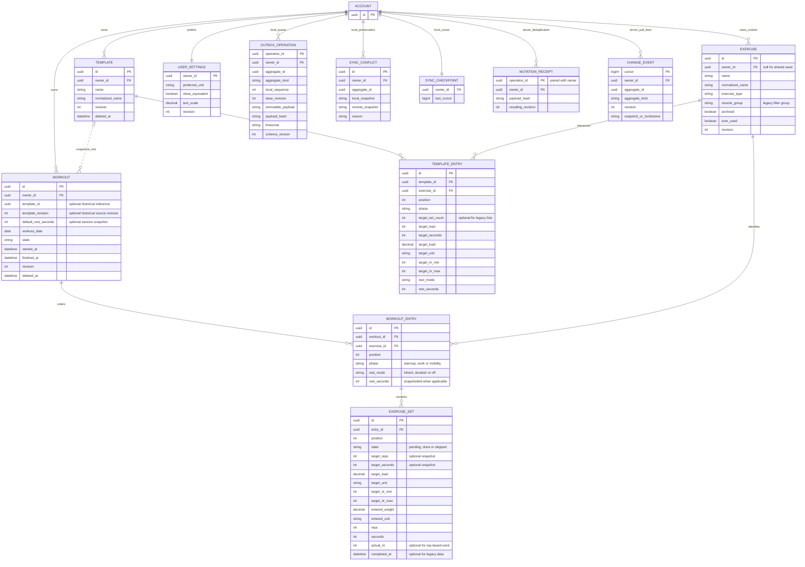

## Persistent entity relationships for profile, catalog and device state

Models catalog provenance and region roles, owner goals and bodyweight, synced reminder preferences and device-local effects.

**Design value:** Separates persisted inputs from derived reports and keeps OS request IDs off the sync feed.

[Edit Mermaid source](diagrams/05-training-data.mmd)

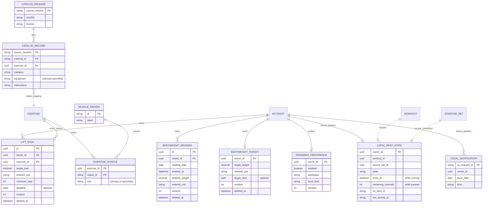

## Class model: controllers and account access

Defines each feature controller, auth gateway/session storage and bootstrap responsibilities. Routes/components delegate to these logical controllers.

**Design value:** Connects user actions to domain operations while keeping Supabase details out of screen code.

[Edit Mermaid source](diagrams/classes/01-ui-and-auth.mmd)

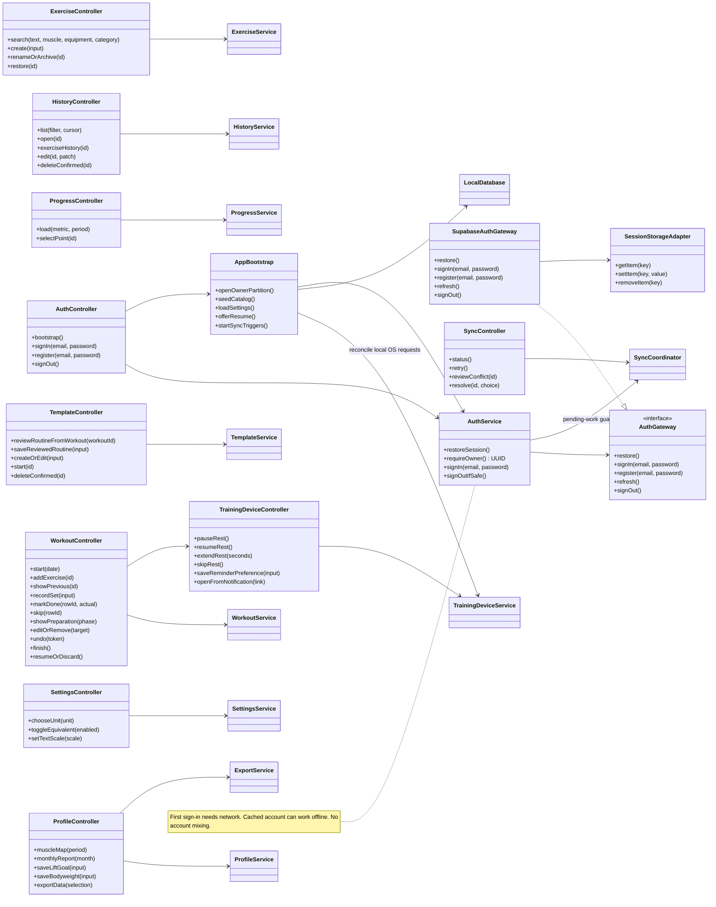

## Class model: domain entities and services

Defines typed workout records, exercise/template/settings entities, validation, service operations and enum values.

**Design value:** Makes exercise-type rules, active/finished states, stable identity and template independence implementable rather than implicit.

[Edit Mermaid source](diagrams/classes/02-domain.mmd)

```mermaid
classDiagram
    direction TB
    class Workout {
      +UUID id
      +UUID ownerId
      +Date workoutDate
      +UUID sourceTemplateId
      +int sourceTemplateRevision
      +int defaultRestSeconds
      +WorkoutState state
      +DateTime startedAt
      +DateTime finishedAt
      +int revision
      +WorkoutEntry[] entries
      +finish()
      +validate()
    }
    class WorkoutEntry {
      +UUID id
      +UUID exerciseId
      +int position
      +TrainingPhase phase
      +RestRule restRule
      +ExerciseSet[] sets
    }
    class ExerciseSet {
      +UUID id
      +int position
      +SetState state
      +SetTarget targetSnapshot
      +Decimal enteredWeight
      +WeightUnit enteredUnit
      +int reps
      +int seconds
      +int actualRir
      +DateTime completedAt
    }
    class Exercise {
      +UUID id
      +UUID ownerId
      +String name
      +String normalizedName
      +ExerciseType type
      +String muscleGroup
      +MuscleRole[] muscleTags
      +bool archived
      +bool everUsed
      +int revision
    }
    class Template {
      +UUID id
      +UUID ownerId
      +String name
      +TemplateEntry[] entries
      +int defaultRestSeconds
      +int revision
    }
    class TemplateEntry {
      +UUID exerciseId
      +int position
      +TrainingPhase phase
      +int targetSetCount
      +SetTarget target
      +RestRule restRule
    }
    class SetTarget {
      +int reps
      +int seconds
      +Decimal load
      +WeightUnit unit
      +int rirMin
      +int rirMax
    }
    class TrainingPhase {
      <<enumeration>>
      warmup
      work
      mobility
    }
    class SetState {
      <<enumeration>>
      pending
      done
      skipped
    }
    class RestRule {
      +String mode
      +int seconds
    }
    class MuscleRole {
      +String regionId
      +String role
    }
    class UserSettings {
      +WeightUnit preferredUnit
      +bool showEquivalent
      +Decimal textScale
      +int revision
    }
    class WorkoutService {
      +start(date)
      +startWithSnapshot(date, routine)
      +addExercise(id)
      +prefill(entryId)
      +recordSet(input)
      +markDone(rowId, actual)
      +skip(rowId)
      +mutateActive(patch)
      +undo(token)
      +finish(confirmSkipPending)
      +resume()
      +discard()
    }
    class ExerciseService {
      +search(text, muscle, equipment, category)
      +create(input)
      +rename(id, name)
      +archiveOrRestore(id)
    }
    class HistoryService {
      +list(filter, cursor)
      +getWorkout(id)
      +latestPerformance(exerciseId)
      +exerciseHistory(id)
      +editFinished(id, patch)
      +deleteWorkout(id)
    }
    class TemplateService {
      +reviewFromWorkout(id)
      +saveReviewedRoutine(input)
      +save(input)
      +startWorkout(id)
      +delete(id)
    }
    class SettingsService {
      +load()
      +update(patch)
    }
    class ProgressService {
      +exerciseSeries(id, period)
      +weeklySeries(period)
      +contributingWorkouts(point)
    }
    class InputValidator {
      +validateDate(date, timezone)
      +validateTypedSet(input, exercise)
      +validateSetTarget(target, exercise)
      +validateName(name)
      +normalizeName(name)
    }
    class UndoToken {
      +UUID workoutId
      +Workout priorSnapshot
      +bool available
    }
    Workout "1" *-- "0..*" WorkoutEntry
    WorkoutEntry "1" *-- "0..*" ExerciseSet
    WorkoutEntry --> Exercise
    WorkoutEntry --> TrainingPhase
    WorkoutEntry --> RestRule
    ExerciseSet --> SetState
    ExerciseSet "1" *-- "0..1" SetTarget : historical target
    TemplateEntry "1" *-- "0..1" SetTarget : routine target
    TemplateEntry --> TrainingPhase
    TemplateEntry --> RestRule
    Exercise "1" *-- "0..*" MuscleRole
    Template "1" *-- "1..*" TemplateEntry
    TemplateEntry --> Exercise
    WorkoutService --> InputValidator
    WorkoutService --> UndoToken
    WorkoutService --> WorkoutRepository
    WorkoutService --> ExerciseRepository
    WorkoutService --> HistoryService
    WorkoutService --> TrainingDeviceService : after confirmed work change
    ExerciseService --> InputValidator
    ExerciseService --> ExerciseRepository
    HistoryService --> InputValidator
    HistoryService --> WorkoutRepository
    TemplateService --> TemplateRepository
    TemplateService --> ExerciseRepository
    TemplateService --> WorkoutService
    SettingsService --> SettingsRepository
    ProgressService --> WorkoutRepository
    ProgressService --> VolumeCalculator
    note for Exercise "Stable ID. Types: weight_reps, reps_only, seconds. Shared seed<br/>immutable; custom type locks after use."
    note for ExerciseSet "Targets and actual values are separate. Only done rows have actuals.<br/>Typed fields and original kg/lb values are preserved."
    note for Workout "One active per owner. Planned finish requires a completed working set.<br/>Pending rows are skipped only after confirmation. Dates cannot be future."
    class WorkoutState {
      <<enumeration>>
      in_progress
      finished
    }
    class ExerciseType {
      <<enumeration>>
      weight_reps
      reps_only
      seconds
    }
    class WeightUnit {
      <<enumeration>>
      kg
      lb
    }
    Workout --> WorkoutState
    Exercise --> ExerciseType
    ExerciseSet --> WeightUnit
    WorkoutService --> UnitConverter
```

## Class model: repositories and backend handlers

Defines repository ports, SQLite adapters, transactions, sync coordination/gateway and logical PostgreSQL handlers.

**Design value:** Supplies the database-handler and API-controller responsibilities required by the assignment and supports failure recovery.

[Edit Mermaid source](diagrams/classes/03-persistence-and-sync.mmd)

```mermaid
classDiagram
    direction TB
    class WorkoutRepository {
      <<interface>>
      +active()
      +get(id)
      +list(filter, cursor)
      +latestPerformance(exerciseId)
      +mutateAndEnqueue(snapshot)
      +deleteAndEnqueue(id)
    }
    class ExerciseRepository {
      <<interface>>
      +search(text, muscle, equipment, category)
      +get(id)
      +mutateAndEnqueue(snapshot)
    }
    class TemplateRepository {
      <<interface>>
      +list()
      +get(id)
      +mutateAndEnqueue(snapshot)
      +deleteAndEnqueue(id)
    }
    class ProfileRepository {
      <<interface>>
      +loadOwnerSnapshot(period)
      +saveGoalAndEnqueue(input)
      +saveBodyweightAndEnqueue(input)
      +saveBodyweightTargetAndEnqueue(input)
      +deleteAndEnqueue(id)
    }
    class DeviceStateRepository {
      <<interface>>
      +getRest(ownerId)
      +saveRest(state)
      +replaceAlertIds(ownerId, ids)
    }
    class SettingsRepository {
      <<interface>>
      +get()
      +mutateAndEnqueue(snapshot)
      +getReminderPreferences()
      +saveReminderPreferencesAndEnqueue(input)
    }
    class SqliteRepositories {
      +ownerId
      +read(query)
      +mutateAndEnqueue(snapshot)
      +deleteAndEnqueue(id)
    }
    class LocalDatabase {
      +openForOwner(ownerId)
      +migrate()
      +transaction(work)
      +emitChanged()
    }
    class CatalogImporter {
      +verifyPinnedRelease()
      +mergeByStableId()
    }
    class OutboxOperation {
      +UUID operationId
      +UUID aggregateId
      +String aggregateKind
      +int localSequence
      +int baseRevision
      +String immutablePayload
      +String payloadHash
      +String timezone
      +int schemaVersion
    }
    class SyncStore {
      +nextReadyOperation()
      +ackAndRebase(receipt)
      +applyPageAndCheckpoint(page)
      +preserveConflict(local, remote)
      +resolveConflict(id, choice)
    }
    class SyncCoordinator {
      +onForegroundOrReconnect()
      +sync()
      +retry()
      +status()
      +resolve(id, choice)
      +hasPendingOrConflicts()
    }
    class SyncGateway {
      <<interface>>
      +applyMutation(operation)
      +pullChanges(cursor)
    }
    class SupabaseSyncGateway {
      +applyMutation(operation)
      +pullChanges(cursor)
    }
    class MutationHandler {
      +apply_mutation(operation, jwt)
      +validateOwnerAndReferences()
      +checkReceiptAndRevision()
      +commitAggregateAndReceipt()
    }
    class ChangeFeedHandler {
      +pull_changes(cursor, jwt)
      +ownerScopedPageAtHighWater()
    }
    class RemoteDatabase {
      +transaction(work)
      +enforceRLS()
      +lockAggregate()
    }
    SqliteRepositories ..|> WorkoutRepository
    SqliteRepositories ..|> ExerciseRepository
    SqliteRepositories ..|> TemplateRepository
    SqliteRepositories ..|> SettingsRepository
    SqliteRepositories ..|> ProfileRepository
    SqliteRepositories ..|> DeviceStateRepository
    CatalogImporter --> LocalDatabase
    CatalogImporter --> ExerciseRepository
    SqliteRepositories --> LocalDatabase
    LocalDatabase --> OutboxOperation
    SyncCoordinator --> SyncStore
    SyncStore --> LocalDatabase
    SyncCoordinator --> SyncGateway
    SupabaseSyncGateway ..|> SyncGateway
    SupabaseSyncGateway --> MutationHandler : authenticated RPC
    SupabaseSyncGateway --> ChangeFeedHandler : authenticated RPC
    MutationHandler --> RemoteDatabase
    ChangeFeedHandler --> RemoteDatabase
    note for MutationHandler "Logical PostgreSQL RPC handler. RLS reads; direct table writes<br/>blocked. Owner-checked narrow RPC, receipt dedupe, revision validation<br/>and child writes in one transaction."
    note for DeviceStateRepository "Owner-partitioned timer and OS request state. Device effects stay<br/>on the device that started them."
    note for ProfileRepository "Goals and bodyweight mutations enqueue owner-scoped snapshots.<br/>Reports, muscle scores and exports read confirmed local records."
    note for SyncStore "Local changes plus immutable outbox are atomic. Acks must not<br/>overwrite newer local edits."
    note for SyncCoordinator "Custom exercise dependencies first. Conflict preserves both versions;<br/>retry is idempotent. No guaranteed OS-background uploads."
```

## Class model: conversion, progress and readability

Defines unit conversion, progress and accessibility presentation alongside muscle scoring, monthly reports, CSV export and device adapters.

**Design value:** Ensures graphs and plain summaries use the same numbers, and display conversion never corrupts originals.

[Edit Mermaid source](diagrams/classes/04-presentation.mmd)

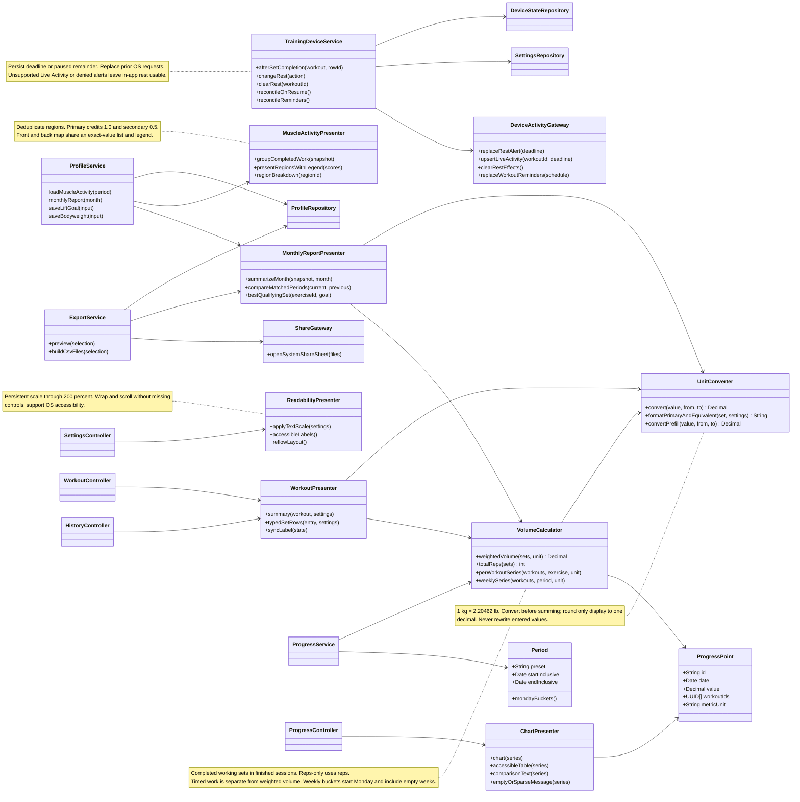

## Class model: synchronization records

Details operation snapshots, preserved conflicts, checkpoints, remote receipts and ordered change events.

**Design value:** Makes duplicate prevention, resumable pull and conflict preservation concrete types with durable fields.

[Edit Mermaid source](diagrams/classes/05-sync-records.mmd)


## Supporting sequence: authentication and bootstrap

Shows first online sign-in, offline reopening of a known account, owner-partition initialization and sign-out safeguards.

**Design value:** Fills the selected specification's sign-in assumption without silently mixing account data or dropping pending work.

[Edit Mermaid source](diagrams/sequence/SUP-01-auth-and-bootstrap.mmd)

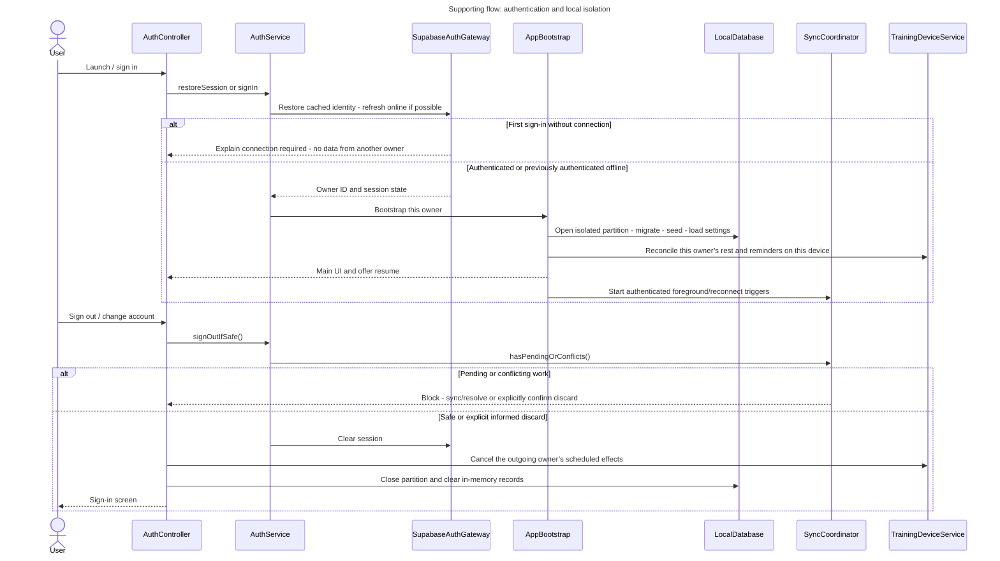

## Supporting sequence: reviewed conflict resolution

Shows presentation of preserved local/remote versions and explicit, validated resolution.

**Design value:** Resolves the source's undefined two-device-offline rule without a silent last-write-wins overwrite.

[Edit Mermaid source](diagrams/sequence/SUP-02-conflict-resolution.mmd)

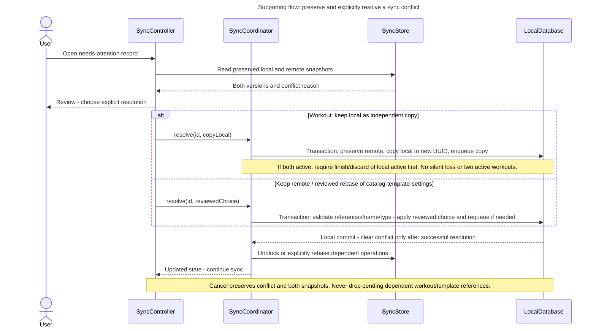

## FW-01: Start a workout, add exercises

As an experienced lifter, I want to start a workout and add exercises as I go, so that I can log in the order I actually train. The flow identifies its UI controller, domain service and data boundary.

**Design value:** Specifies active-workout uniqueness and ordered exercise entry before logging.

[Edit Mermaid source](diagrams/sequence/FW-01.mmd)

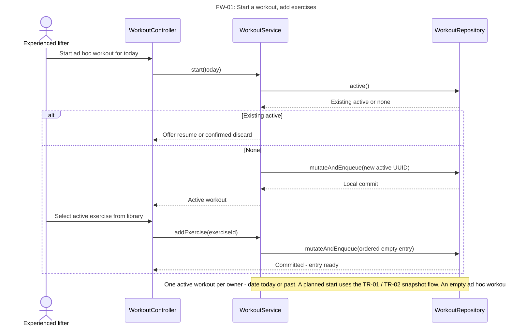

## FW-02: Record a set with prefill

As an experienced lifter, I want to record a set by entering weight and reps, prefilled from my previous set, so that I can log between sets without losing rest time. The flow identifies its UI controller, domain service and data boundary.

**Design value:** Separates the planned target from suggested and confirmed actuals.

[Edit Mermaid source](diagrams/sequence/FW-02.mmd)

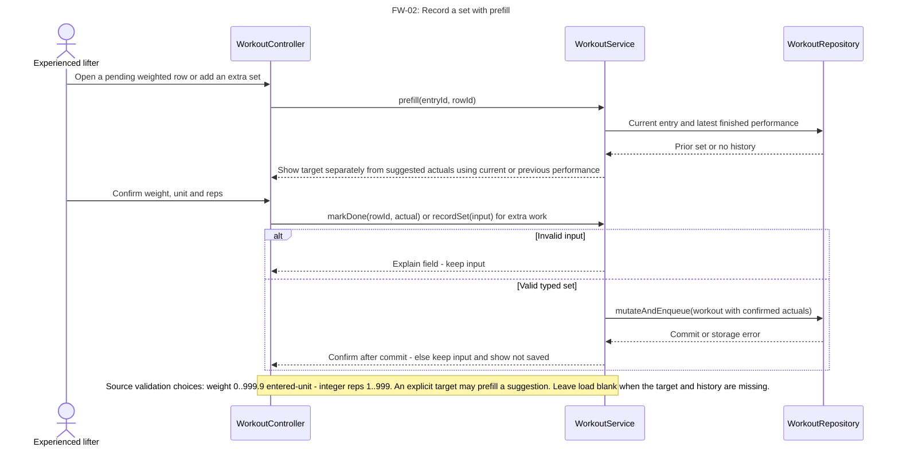

## FW-03: Set form matches exercise type

As a home trainer, I want the set form to ask only for what applies to the exercise, so that I am not forced to enter a weight for push-ups or planks. The flow identifies its UI controller, domain service and data boundary.

**Design value:** Prevents irrelevant weight/repetition fields from leaking into other exercise types.

[Edit Mermaid source](diagrams/sequence/FW-03.mmd)

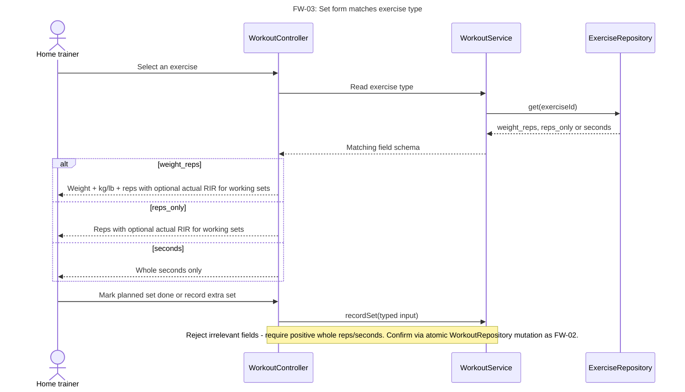

## FW-04: See previous performance

As a beginner lifter, I want to see what I did the last time I performed an exercise while I log it, so that I can choose today’s weight instead of guessing. The flow identifies its UI controller, domain service and data boundary.

**Design value:** Defines which prior session is shown and how local corrections affect it.

[Edit Mermaid source](diagrams/sequence/FW-04.mmd)

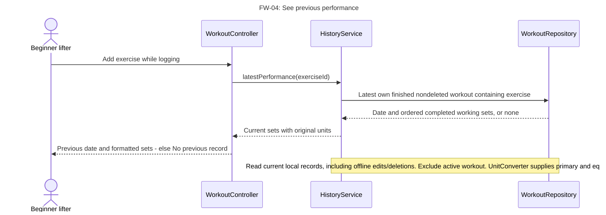

## FW-05: Correct or remove a set or entry

As an experienced lifter, I want to correct or remove a set, or remove an entry, during a workout, so that one mistaken tap does not corrupt my history. The flow identifies its UI controller, domain service and data boundary.

**Design value:** Preserves correction, confirmation and immediate undo behavior without renumbering corruption.

[Edit Mermaid source](diagrams/sequence/FW-05.mmd)

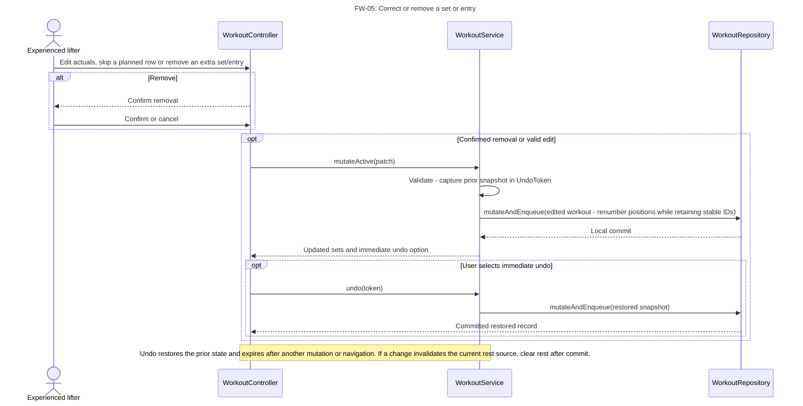

## FW-06: Finish workout, see summary

As a returning lifter, I want to finish a workout and see a short, plain summary, so that I know it is saved and can read what I did. The flow identifies its UI controller, domain service and data boundary.

**Design value:** Separates planned-session eligibility and confirmed skips from the ad hoc finish path.

[Edit Mermaid source](diagrams/sequence/FW-06.mmd)

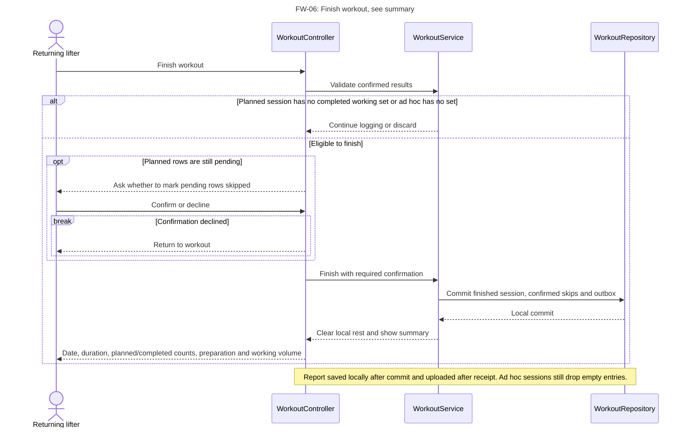

## FW-07: Resume an unfinished workout

As a beginner lifter, I want my unfinished workout to still be there if I switch apps or my phone locks, so that an interruption does not cost me the session. The flow identifies its UI controller, domain service and data boundary.

**Design value:** Restores plan snapshots, completion states and device-local rest after relaunch.

[Edit Mermaid source](diagrams/sequence/FW-07.mmd)

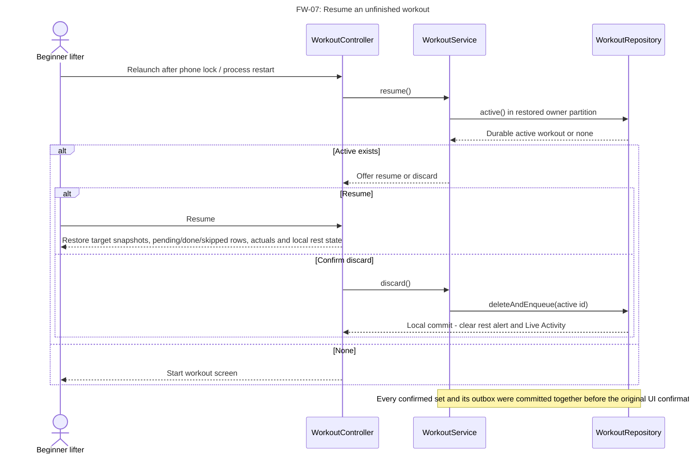

## FW-08: Record a workout on an earlier date

As a home trainer, I want to record a workout I already did by choosing an earlier date, so that I can catch up when I could not use my phone during the session. The flow identifies its UI controller, domain service and data boundary.

**Design value:** Separates a training calendar date from timestamps so delayed logging is graphed correctly.

[Edit Mermaid source](diagrams/sequence/FW-08.mmd)

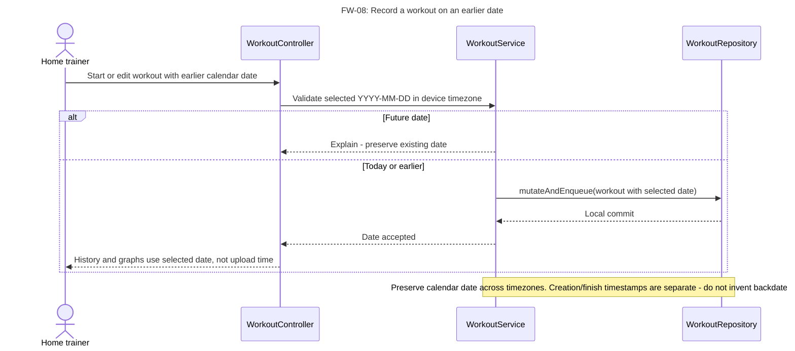

## FW-09: Log offline, upload later

As a home trainer, I want to log a workout when I have no connection and have it uploaded later, so that I never lose a session because of my signal. The flow identifies its UI controller, domain service and data boundary.

**Design value:** Models the highest-risk cross-system path, including retries, receipts, conflicts and pull checkpoints.

[Edit Mermaid source](diagrams/sequence/FW-09.mmd)

```mermaid
sequenceDiagram
    title FW-09: Log offline, upload later
    actor U as Home trainer
    participant C as SyncController
    participant S as SyncCoordinator
    participant R as SyncStore
    participant G as SupabaseSyncGateway
    participant H as MutationHandler / ChangeFeedHandler
    participant DB as RemoteDatabase
    U->>C: Log while offline
    Note over U,R: Logging services atomically persist local records plus immutable OutboxOperation. UI shows saved on device / waiting.
    C->>S: onForegroundOrReconnect()
    S->>R: nextReadyOperation() in dependency and per-root order
    R-->>S: Snapshot, UUID, owner, base revision, hash
    S->>G: applyMutation(operation, authenticated session)
    G->>H: apply_mutation
    alt Receipt exists with same payload
     H-->>G: Original receipt
    else Revision or name/type/active-state conflict
     H-->>G: Conflict with remote snapshot
    else Valid authorized mutation
     H->>DB: Transaction: validate, lock root, write children, receipt + change feed
     DB-->>H: New revision
     H-->>G: Receipt
    end
    G-->>S: Receipt, conflict, auth error or retryable failure
    alt Receipt
     S->>R: ackAndRebase -  never overwrite newer local edits
    else Conflict
     S->>R: preserveConflict(local, remote) -  block this root
     S-->>C: Needs attention -  explicit reviewed resolution
    else Offline / expired auth
     S-->>C: Keep queue -  waiting or needs sign-in
    end
    S->>G: pullChanges(checkpoint)
    G->>H: pull_changes at server high-water cursor
    H->>DB: Owner-scoped ordered changes including tombstones
    DB-->>H: Page and next cursor
    H-->>G: Authorized change page
    G-->>S: Page and next cursor
    S->>R: Apply page + checkpoint atomically -  preserve dirty conflicts
    Note over S,R: Sync routines, workouts, goals, bodyweight and preferences. Timer state and OS request IDs are device local.<br/>Retries use same operation ID -  conflict never silently overwrites. Sync runs while active, not guaranteed after OS termination.
    Note over H,DB: Block direct client table writes. Narrow RPC uses fixed search path and explicit authenticated owner checks -  receipt/feed changes commit with the root.
```

## FW-10: Choose kg or lb

As a beginner lifter, I want to choose whether weights are shown in kg or lb, so that entries match the plates and machines I use. The flow identifies its UI controller, domain service and data boundary.

**Design value:** Keeps account display preferences separate from immutable entered measurements.

[Edit Mermaid source](diagrams/sequence/FW-10.mmd)

```mermaid
sequenceDiagram
    title FW-10: Choose kg or lb
    actor U as Beginner lifter
    participant C as SettingsController
    participant S as SettingsService
    participant R as SettingsRepository
    U->>C: Choose kg or lb on first use or settings
    C->>S: update(preferredUnit)
    S->>R: mutateAndEnqueue(settings)
    R-->>S: Local commit
    S-->>C: New display preference
    C-->>U: Entry, history, summaries and graphs rerender in preferred unit
    Note over C,R: Stored set weight/unit never changes. Convert unrounded values before aggregation -  display one decimal.
```

## FW-11: Find an exercise; recent first

As a beginner lifter, I want to find an exercise by typing part of its name or filtering by muscle group, with recent ones first, so that I can add the right exercise without knowing its exact name. The flow identifies its UI controller, domain service and data boundary.

**Design value:** Defines offline catalog search and stable exercise selection.

[Edit Mermaid source](diagrams/sequence/FW-11.mmd)

```mermaid
sequenceDiagram
    title FW-11: Find an exercise -  recent first
    actor U as Beginner lifter
    participant C as ExerciseController
    participant S as ExerciseService
    participant R as ExerciseRepository
    U->>C: Type part of name and optionally select muscle, equipment or category
    C->>S: search(text, muscle, equipment, category)
    S->>R: Search shared + own active exercises locally
    R-->>S: Case-insensitive substring plus filter matches
    S-->>C: Results -  with empty text recent exercises first
    alt No matches
     C-->>U: No match -  offer create custom exercise
    else Matches
     C-->>U: Select exercise by stable ID
    end
    Note over S,R: Use the pinned offline catalog plus the user’s own records. Preserve stable IDs and recent-first behavior.
```

## FW-12: Create a custom exercise

As a home trainer, I want to create my own exercise with a name and a type, so that I can log home and unusual movements the library lacks. The flow identifies its UI controller, domain service and data boundary.

**Design value:** Specifies private custom exercise creation, name conflicts and eventual type locking.

[Edit Mermaid source](diagrams/sequence/FW-12.mmd)

```mermaid
sequenceDiagram
    title FW-12: Create a custom exercise
    actor U as Home trainer
    participant C as ExerciseController
    participant S as ExerciseService
    participant R as ExerciseRepository
    U->>C: Name, logging type and optional primary and secondary tags
    C->>S: create(input)
    S->>S: Validate name -  ignore case and spaces for uniqueness (A-EX-2)
    S->>R: Check name against shared and own custom catalog
    alt Duplicate or invalid
     S-->>C: Explain and retain form
    else Unique
     S->>R: mutateAndEnqueue(new owned exercise UUID)
     R-->>S: Local commit
     S-->>C: Exercise available offline to its creator only
    end
    Note over S,R: Nonempty name up to source-proposed 60 chars. Type becomes immutable after any set references it. Sync uploads exercise before dependent workout/template.
```

## FW-13: Rename or archive a custom exercise

As an experienced lifter, I want to rename or archive a custom exercise, so that I can tidy my library without losing history. The flow identifies its UI controller, domain service and data boundary.

**Design value:** Keeps rename/archive changes attached to stable exercise identities and historical sets.

[Edit Mermaid source](diagrams/sequence/FW-13.mmd)

```mermaid
sequenceDiagram
    title FW-13: Rename or archive a custom exercise
    actor U as Experienced lifter
    participant C as ExerciseController
    participant S as ExerciseService
    participant R as ExerciseRepository
    U->>C: Rename, archive or restore custom exercise
    C->>S: rename / archiveOrRestore(id)
    S->>R: Read owner and shared/custom state
    alt Shared exercise or name invalid/duplicate
     S-->>C: Reject -  preserve existing exercise
    else Own custom exercise
     S->>R: mutateAndEnqueue(same ID, changed name/archive flag)
     R-->>S: Local commit
     S-->>C: Search refreshed -  history and graphs resolve current name
    end
    Note over S,R: Archive hides picker entry but preserves sets and template references. Restore is available. Used exercises cannot be deleted or change type.
```

## FW-14: List finished workouts

As a returning lifter, I want to see a list of my finished workouts with dates, exercises and number of sets, so that I can quickly check when and what I trained. The flow identifies its UI controller, domain service and data boundary.

**Design value:** Defines an accessible paged list with stable ordering and an honest empty state.

[Edit Mermaid source](diagrams/sequence/FW-14.mmd)

```mermaid
sequenceDiagram
    title FW-14: List finished workouts
    actor U as Returning lifter
    participant C as HistoryController
    participant S as HistoryService
    participant R as WorkoutRepository
    U->>C: Open history / scroll for older rows
    C->>S: list(filter, cursor)
    S->>R: Own finished nondeleted workouts ordered date DESC, ID DESC
    R-->>S: Page and stable next cursor
    S-->>C: Date, first three exercise names, and N more, set count
    alt Empty history
     C-->>U: Explain how to log first workout
    else Rows exist
     C-->>U: Readable dated list using saved text scale
    end
    Note over C,R: Include locally finished pending uploads. Pagination uses date plus ID -  source three-name row layout is a display rule, not a capacity promise.
```

## FW-15: Open a past workout

As an experienced lifter, I want to open a past workout and see every exercise and set as recorded, so that I can plan a repeat or check what I did. The flow identifies its UI controller, domain service and data boundary.

**Design value:** Provides complete, current records without forcing users through graphs.

[Edit Mermaid source](diagrams/sequence/FW-15.mmd)

```mermaid
sequenceDiagram
    title FW-15: Open a past workout
    actor U as Experienced lifter
    participant C as HistoryController
    participant S as HistoryService
    participant R as WorkoutRepository
    U->>C: Open past workout ID
    C->>S: getWorkout(id)
    S->>R: Owner-scoped finished nondeleted workout with entries/sets
    alt Not found or deleted
     R-->>C: Explain and return to list
    else Found
     R-->>S: Current snapshot
     S-->>C: Ordered exercises, planned targets and confirmed actuals
     C-->>U: Date, duration if known, working volume, units and preparation breakdown
    end
    Note over C,S: WorkoutPresenter uses current unit/text preferences -  original weights remain intact. Unsynced edits are visible immediately.
```

## FW-16: History of one exercise

As an experienced lifter, I want to see every time I performed one exercise, with the sets from each session, so that I can follow one lift in numbers. The flow identifies its UI controller, domain service and data boundary.

**Design value:** Makes exercise-level history reachable and robust to renaming/archiving.

[Edit Mermaid source](diagrams/sequence/FW-16.mmd)

```mermaid
sequenceDiagram
    title FW-16: History of one exercise
    actor U as Experienced lifter
    participant C as HistoryController
    participant S as HistoryService
    participant R as WorkoutRepository
    U->>C: Open exercise history from library or workout entry
    C->>S: exerciseHistory(stable exerciseId)
    S->>R: Finished workouts containing exercise, newest first
    R-->>S: Dates and matching typed sets
    S-->>C: Exercise-specific history or empty result
    C-->>U: Readable values in preferred units with equivalents if enabled
    Note over S,R: Archived exercise remains readable. Renaming keeps the same ID -  edits and deletion change this query immediately.
```

## FW-17: Edit a finished workout

As a home trainer, I want to edit a finished workout, so that I can fix mistakes I notice later. The flow identifies its UI controller, domain service and data boundary.

**Design value:** Carries all original validation rules into finished-record correction and derived views.

[Edit Mermaid source](diagrams/sequence/FW-17.mmd)

```mermaid
sequenceDiagram
    title FW-17: Edit a finished workout
    actor U as Home trainer
    participant C as HistoryController
    participant S as HistoryService
    participant R as WorkoutRepository
    U->>C: Edit finished workout date / entries / sets
    C->>S: editFinished(id, patch)
    S->>S: Validate actuals and date. Retain at least one completed working set for planned sessions.
    alt Invalid or empty result
     S-->>C: Explain -  keep saved version and editor input
    else Valid
     S->>R: mutateAndEnqueue(updated full snapshot)
     R-->>S: Local commit
     S-->>C: Updated summary
     C-->>U: Refresh history, graphs, muscle activity, monthly report and goals
    end
    Note over S,R: Works offline -  local data event invalidates derived views. Later upload uses expected revision, with explicit conflict if remote changed.
```

## FW-18: Delete a finished workout

As a home trainer, I want to delete a finished workout after confirming, so that accidental or test entries do not distort my history and graphs. The flow identifies its UI controller, domain service and data boundary.

**Design value:** Explains both user-visible permanent deletion and internal synchronization tombstones.

[Edit Mermaid source](diagrams/sequence/FW-18.mmd)

```mermaid
sequenceDiagram
    title FW-18: Delete a finished workout
    actor U as Home trainer
    participant C as HistoryController
    participant S as HistoryService
    participant R as WorkoutRepository
    U->>C: Delete finished workout
    C-->>U: Confirm workout date and set count
    alt Cancel
     C-->>U: Keep workout unchanged
    else Confirm
     C->>S: deleteWorkout(id)
     S->>R: deleteAndEnqueue(tombstone)
     R-->>S: Local commit
     S-->>C: Deleted locally -  upload pending if offline
     C-->>U: Refresh history, graphs, muscle activity, monthly report and goals
    end
    Note over S,R: No user-facing recycle bin. Keep sync tombstone so cloud deletion propagates and cannot be resurrected by a stale pull.
```

## FW-19: Filter history

As a beginner lifter, I want to narrow my history to a date range or to one exercise, so that I can find a specific period or lift without scrolling. The flow identifies its UI controller, domain service and data boundary.

**Design value:** Prevents date and exercise filters from accidentally replacing each other.

[Edit Mermaid source](diagrams/sequence/FW-19.mmd)

```mermaid
sequenceDiagram
    title FW-19: Filter history
    actor U as Beginner lifter
    participant C as HistoryController
    participant S as HistoryService
    participant R as WorkoutRepository
    U->>C: Select date range and/or exercise
    C->>S: list(combined filter, reset cursor)
    alt Reversed or invalid date range
     S-->>C: Explain -  do not issue invalid query
    else Valid
     S->>R: Finished workouts matching both optional filters
     R-->>S: Paged rows or none
     S-->>C: Results or no-matches message
    end
    U->>C: Clear filters
    C->>S: list(empty filter, reset cursor)
    Note over C,R: Exercise comparison uses stable ID. Dates inclusive. Filters compose, not replace each other.
```

## FW-20: Per-exercise volume graph

As an experienced lifter, I want to see a graph of my total volume for one exercise over time, so that I can tell whether I am lifting more than before. The flow identifies its UI controller, domain service and data boundary.

**Design value:** Ties exercise chart points directly to converted source sets and workout IDs.

[Edit Mermaid source](diagrams/sequence/FW-20.mmd)

```mermaid
sequenceDiagram
    title FW-20: Per-exercise volume graph
    actor U as Experienced lifter
    participant C as ProgressController
    participant S as ProgressService
    participant R as WorkoutRepository
    participant V as VolumeCalculator
    U->>C: Open weighted exercise graph
    C->>S: exerciseSeries(exerciseId, period)
    S->>R: Current finished workouts and matching completed working sets with weight
    R-->>S: Entered weights, units, reps and dates
    S->>V: Convert unrounded weights -  sum weight times reps per workout
    V-->>S: Points with workout IDs and metric unit
    S-->>C: Series and source references
    C-->>U: Dated unit-labelled chart + accessible table + explanation
    Note over C,V: Fewer than two workouts shows sparse-data message. Do not infer strength or health. Timed exercises have no graph.
```

## FW-21: Choose the period

As an experienced lifter, I want to choose the period shown on a graph, so that I can compare recent weeks with the longer trend. The flow identifies its UI controller, domain service and data boundary.

**Design value:** Keeps chart, table and explanation synchronized when period controls change.

[Edit Mermaid source](diagrams/sequence/FW-21.mmd)

```mermaid
sequenceDiagram
    title FW-21: Choose the period
    actor U as Experienced lifter
    participant C as ProgressController
    participant S as ProgressService
    participant R as WorkoutRepository
    participant V as VolumeCalculator
    U->>C: Choose 4 weeks, 12 weeks, 1 year or all time
    C->>S: Recompute current metric for selected Period
    S->>R: Filter by saved workout date, inclusive endpoints
    R-->>S: Matching current workouts
    S->>V: Reaggregate metric and weekly zero buckets if applicable
    V-->>S: New series and text-summary values
    S-->>C: Replace chart, accessible table and summary together
    Note over C,S: All-time begins at earliest finished workout. Empty account shows empty state. Date choice applies to every graph type.
```

## FW-22: Overall weekly volume graph

As a beginner lifter, I want to see my total volume per week across all weight-based exercises, so that I can tell whether I am training more overall. The flow identifies its UI controller, domain service and data boundary.

**Design value:** Defines weekly bucketing, zero weeks and the zero-denominator comparison case.

[Edit Mermaid source](diagrams/sequence/FW-22.mmd)

```mermaid
sequenceDiagram
    title FW-22: Overall weekly volume graph
    actor U as Beginner lifter
    participant C as ProgressController
    participant S as ProgressService
    participant R as WorkoutRepository
    participant V as VolumeCalculator
    U->>C: Open overall weekly volume
    C->>S: weeklySeries(period)
    S->>R: Completed weighted working sets in finished workouts for date range
    R-->>S: Records and dates
    S->>V: Convert to preferred unit -  sum weight times reps by Monday-start week
    V-->>S: Weekly points including zero weeks and source workout IDs
    S-->>C: Points and latest-two-week comparison values
    C-->>U: Chart + table + plain sentence -  label partial weeks
    Note over C,V: Reps-only and timed sets excluded. Previous week zero uses absolute difference, never division by zero.
```

## FW-23: Reps-only total reps graph

As a home trainer, I want to see my total reps per workout for a reps-only exercise, so that I can follow progress on bodyweight exercises. The flow identifies its UI controller, domain service and data boundary.

**Design value:** Avoids assigning weighted volume or kilograms to reps-only exercises.

[Edit Mermaid source](diagrams/sequence/FW-23.mmd)

```mermaid
sequenceDiagram
    title FW-23: Reps-only total reps graph
    actor U as Home trainer
    participant C as ProgressController
    participant S as ProgressService
    participant R as WorkoutRepository
    participant V as VolumeCalculator
    U->>C: Open reps-only exercise progress
    C->>S: exerciseSeries(exerciseId, period)
    S->>R: Completed reps-only working sets in finished workouts
    R-->>S: Date, workout ID and reps
    S->>V: Sum reps per workout
    V-->>S: Reps series
    S-->>C: Points with metric Total reps
    C-->>U: Chart + accessible table and empty/sparse explanation
    Note over C,V: Do not convert reps into weighted volume. Seconds-based exercises are recorded but not graphed.
```

## FW-24: Select a point, open workout

As an experienced lifter, I want to select a point on a graph to see its date and value and open that workout, so that I can understand an unusually high or low session. The flow identifies its UI controller, domain service and data boundary.

**Design value:** Preserves the link from a chart/table point to the actual contributing records.

[Edit Mermaid source](diagrams/sequence/FW-24.mmd)

```mermaid
sequenceDiagram
    title FW-24: Select a point, open workout
    actor U as Experienced lifter
    participant C as ProgressController
    participant S as ProgressService
    participant R as WorkoutRepository
    U->>C: Select chart point or equivalent table row
    C->>S: contributingWorkouts(pointId)
    S->>R: Resolve current nondeleted workout IDs behind point
    R-->>S: Contributing records
    S-->>C: Date/value and source records
    alt Exercise point
     C-->>U: Open workout detail
    else Weekly point with workouts
     C-->>U: List contributing workouts -  choose one to open
    else Empty week / removed source
     C-->>U: Explain no contributing workout -  refresh series
    end
    Note over C,S: Accessible table selection supports same drill-down. Do not route by displayed date alone.
```

## FW-25: Save workout as template

As a home trainer, I want to save the exercises of a finished workout as a named template, so that I can start my usual routine again without re-entering it. The flow identifies its UI controller, domain service and data boundary.

**Design value:** Makes conversion of actual load and RIR into targets an explicit choice.

[Edit Mermaid source](diagrams/sequence/FW-25.mmd)

```mermaid
sequenceDiagram
    title FW-25: Save workout as template
    actor U as Home trainer
    participant C as TemplateController
    participant S as TemplateService
    participant R as TemplateRepository
    participant W as HistoryService
    U->>C: Save finished workout as a routine
    C->>S: reviewFromWorkout(workoutId)
    S->>W: getWorkout(workoutId)
    W-->>S: Ordered entries, available targets and confirmed results
    S-->>U: Review name, exercise order and editable targets
    U->>C: Confirm reviewed routine
    C->>S: saveReviewedRoutine(input)
    S->>R: Check unique owner name and validate targets
    alt Invalid input
        S-->>C: Explain and preserve editor
    else Valid
        S->>R: Commit new routine and outbox
        R-->>C: Saved locally
    end
    Note over S,R: Actual load and RIR become targets only by explicit choice. The source workout keeps its own results.
```

## FW-26: Start workout from template

As an experienced lifter, I want to start a workout from a template, so that its exercises are already in the workout when I begin. The flow identifies its UI controller, domain service and data boundary.

**Design value:** Snapshots ordered targets while preserving legacy exercise-only routines.

[Edit Mermaid source](diagrams/sequence/FW-26.mmd)

```mermaid
sequenceDiagram
    title FW-26: Start workout from template
    actor U as Experienced lifter
    participant C as TemplateController
    participant S as TemplateService
    participant R as TemplateRepository
    participant W as WorkoutService
    U->>C: Select a saved routine and workout date
    C->>S: startWorkout(templateId)
    S->>R: Load ordered entries, targets and archive flags
    R-->>S: Routine and exercise references
    S-->>C: Mark archived exercises and offer skip
    U->>C: Confirm selection
    C->>S: Start with the approved entries
    S->>W: Create independent target snapshot for retained entries
    W-->>C: Commit active session and outbox
    C-->>U: Show pending rows and actual fields
    Note over C,S: Existing active workout offers resume or discard. Legacy exercise-only routines open with empty typed entries and previous performance.
```

## FW-27: Create and edit a template

As a beginner lifter, I want to create and edit a template by choosing exercises myself, so that I can set up my plan at home before going to the gym. The flow identifies its UI controller, domain service and data boundary.

**Design value:** Applies routine changes only to future workouts.

[Edit Mermaid source](diagrams/sequence/FW-27.mmd)

```mermaid
sequenceDiagram
    title FW-27: Create and edit a template
    actor U as Beginner lifter
    participant C as TemplateController
    participant S as TemplateService
    participant R as TemplateRepository
    U->>C: Create or edit named routine
    C-->>U: Search, add, reorder and set typed targets, RIR or rest
    U->>C: Save ordered routine
    C->>S: save(name, ordered entries and targets)
    S->>S: Validate unique owner name, entries and target ranges
    S->>R: mutateAndEnqueue(template snapshot)
    R-->>S: Local commit or validation/storage failure
    S-->>C: Saved after commit -  else explain and keep editor
    Note over C,R: Routine edits apply to later starts. Existing snapshots keep their targets. Archived references stay marked.
```

## FW-28: Delete a template

As an experienced lifter, I want to delete a template, so that I can retire routines I no longer use. The flow identifies its UI controller, domain service and data boundary.

**Design value:** Ensures deleting a saved routine never deletes workouts started from it.

[Edit Mermaid source](diagrams/sequence/FW-28.mmd)

```mermaid
sequenceDiagram
    title FW-28: Delete a template
    actor U as Experienced lifter
    participant C as TemplateController
    participant S as TemplateService
    participant R as TemplateRepository
    U->>C: Delete a saved template
    C-->>U: Confirmation with template name
    alt Cancel
     C-->>U: Template unchanged
    else Confirm
     C->>S: delete(templateId)
     S->>R: deleteAndEnqueue(template tombstone)
     R-->>S: Local commit
     S-->>C: Template removed from list
    end
    Note over S,R: Active and finished sessions retain their independent snapshots. Tombstone uploads through the same durable queue.
```

## FW-29: Larger text size

As a returning lifter, I want to make the text larger, so that I can read my workouts and summaries without straining. The flow identifies its UI controller, domain service and data boundary.

**Design value:** Makes large text a persistent app-wide presentation behavior.

[Edit Mermaid source](diagrams/sequence/FW-29.mmd)

```mermaid
sequenceDiagram
    title FW-29: Larger text size
    actor U as Returning lifter
    participant C as SettingsController
    participant S as SettingsService
    participant R as SettingsRepository
    participant P as ReadabilityPresenter
    U->>C: Choose larger text up to 200 percent
    C->>S: update(textScale)
    S->>R: mutateAndEnqueue(settings)
    R-->>S: Local commit
    S-->>C: Persistent preference
    C->>P: applyTextScale and reflowLayout
    P-->>U: Readable entry, history, summary, routine, profile and settings controls
    Note over C,P: Wrap/scroll without losing content. Provide plain labels, screen-reader labels and text/table chart alternatives. Restore preference at launch.
```

## FW-30: See both units

As a returning lifter, I want to see each weight with its equivalent in the other unit, so that I know how much to load when a gym’s plates use a different unit. The flow identifies its UI controller, domain service and data boundary.

**Design value:** Uses one conversion/formatting path for every equivalent weight display.

[Edit Mermaid source](diagrams/sequence/FW-30.mmd)

```mermaid
sequenceDiagram
    title FW-30: See both units
    actor U as Returning lifter
    participant C as SettingsController
    participant S as SettingsService
    participant R as SettingsRepository
    participant P as UnitConverter
    U->>C: Enable or disable equivalent weight display
    C->>S: update(showEquivalent)
    S->>R: mutateAndEnqueue(settings)
    R-->>S: Local commit
    S-->>C: Updated presentation preference
    C->>P: formatPrimaryAndEquivalent(set, settings)
    P-->>U: For example 60 kg (132.3 lb), or primary value only
    Note over C,P: Weighted set rows, previous performance and summaries use same formatter. Factor 2.20462 -  display one decimal -  no stored value changes.
```

## FW-31: Enter a set in either unit

As a returning lifter, I want to enter a set in either kg or lb, so that I can log what the plates say without converting. The flow identifies its UI controller, domain service and data boundary.

**Design value:** Prevents a unit switch from silently reinterpreting a number without conversion.

[Edit Mermaid source](diagrams/sequence/FW-31.mmd)

```mermaid
sequenceDiagram
    title FW-31: Enter a set in either unit
    actor U as Returning lifter
    participant C as WorkoutController
    participant S as WorkoutService
    participant R as WorkoutRepository
    participant P as UnitConverter
    U->>C: Open weighted-set form
    C-->>U: Unit defaults to preferred account unit
    U->>C: Choose kg or lb and enter value
    opt Switch unit after entering a value
     C->>P: convertPrefill(value, old unit, new unit)
     P-->>C: Converted value -  explicit confirmation, no silent relabel
    end
    C->>S: markDone(rowId, enteredWeight, enteredUnit, reps) or record extra set
    S->>S: Validate bounds in entered unit and typed fields
    S->>R: mutateAndEnqueue(set with original decimal and unit)
    R-->>S: Local commit
    S-->>C: Confirm set
    C-->>U: Preferred-unit value plus optional equivalent
    Note over S,R: Prefill converts when source unit differs. History/graphs convert at read time. Switching display preference preserves original actuals and planned targets.
```

## TR-01 / TR-02: Plan a routine and complete working sets

Shows reusable targets, durable session snapshots, typed actuals, skip, undo and finish.

**Design value:** Makes the planned-row workflow and local confirmation explicit.

[Edit Mermaid source](diagrams/sequence/TR-01-02-planned-training.mmd)

```mermaid
sequenceDiagram
    title TR-01 / TR-02: Plan a routine and complete working sets
    actor U as Lifter
    participant T as TemplateController
    participant P as TemplateService
    participant C as WorkoutController
    participant W as WorkoutService
    participant R as WorkoutRepository
    U->>T: Save ordered exercise targets and optional rest
    T->>P: Validate typed targets, set count and optional RIR range
    P-->>U: Saved after local routine commit
    U->>T: Start the saved routine
    T->>P: Load current routine and review archived entries
    P->>W: Start with approved targets and stable pending rows
    W->>R: Atomically save session snapshot and outbox
    R-->>C: Show targets and editable actual fields
    Note over T,R: Existing active session offers resume or discard. Older lists open with empty entries and no invented targets.
    U->>C: Enter actual reps, load/unit or time, and optional actual RIR
    C->>W: Mark done for existing row ID
    alt Invalid actual or commit fails
        W-->>C: Keep input. The row stays pending.
    else Commit succeeds
        W->>R: Persist typed actuals, done state and outbox
        R-->>C: Update completed count
        Note over C,W: Confirmed working-set completion can start rest in TR-03. Duplicate completion does not create another result.
    end
    opt Skip, undo, or add an extra set
        U->>C: Change the current session
        C->>W: Validate transition without changing the routine
        W->>R: Atomically persist new session snapshot and outbox
    end
    U->>C: Finish workout
    alt No working set done
        C-->>U: Continue logging or discard
    else Working set done
        opt Rows are pending
            C-->>U: Confirm marking pending rows skipped
            U->>C: Confirm or decline
            break Confirmation declined
                C-->>U: Return to active workout
            end
        end
        C->>W: Finish after required confirmation
        W->>R: Persist finished session and outbox
        R-->>U: Summary with planned and completed counts
    end
```

## TR-03 / TR-13: Rest countdown and iOS Lock Screen

Shows a device-local deadline, alert replacement, optional Live Activity, relaunch and cleanup.

**Design value:** Explains how rest continues under OS control when the app is suspended.

[Edit Mermaid source](diagrams/sequence/TR-03-13-rest-and-live-activity.mmd)

```mermaid
sequenceDiagram
    title TR-03 / TR-13: Rest countdown and iOS Lock Screen
    actor U as Lifter
    participant W as WorkoutService
    participant D as TrainingDeviceService
    participant R as DeviceStateRepository
    participant G as DeviceActivityGateway
    W->>D: Working-set completion committed
    alt Auto-rest enabled and another working set remains
        D->>R: Replace local state with source set and absolute deadline
        D->>G: Reconcile previous alert and activity
        opt Alert permission granted
            G->>G: Schedule one rest-end alert for deadline
        end
        opt iOS supports and permits Live Activities
            G->>G: Upsert system countdown and active workout link
        end
        G-->>R: Save current OS request IDs locally
        D-->>U: Show in-app countdown
    else No eligible rest
        D->>G: Clear prior rest effects
        D->>R: Clear rest state
    end
    U->>G: Lock phone or leave app
    Note over G: System renders deadline countdown and can deliver its scheduled alert while the app is suspended.
    U->>D: Reopen workout, optionally through the activity or alert
    D->>R: Read persisted deadline or paused remainder
    D-->>U: Restore countdown or show rest complete
    opt Pause, resume, extend or skip
        U->>D: Change rest
        D->>R: Persist remaining time, updated deadline or ended state
        D->>G: Replace or cancel old alert and update or end activity
    end
    opt Undo the triggering completion, finish or discard
        W->>D: Source is no longer active
        D->>G: Cancel alert and end activity
        D->>R: Clear rest state
    end
    Note over D,R: Effects belong to the starting device. Reconcile OS requests after interruption. Timer state stays on the device.
```

## TR-04 / TR-05: Warm-up and targeted mobility

Shows editable warm-up and mobility steps before or after working sets.

**Design value:** Preserves preparation in history and excludes it from working-set totals.

[Edit Mermaid source](diagrams/sequence/TR-04-05-preparation.mmd)

```mermaid
sequenceDiagram
    title TR-04 / TR-05: Warm-up and targeted mobility
    actor U as Lifter
    participant C as WorkoutController
    participant E as ExerciseService
    participant W as WorkoutService
    participant R as WorkoutRepository
    U->>C: Review optional preparation for the selected routine
    C->>E: Find matching warm-up and mobility content by exercise or area
    E-->>C: General movement, lighter lift steps and targeted mobility
    C-->>U: Instructions and editable rep or duration targets
    alt Lifter edits or substitutes a step
        U->>C: Select replacement and confirm targets
        C->>W: Validate and save preparation on this session
    else Lifter skips the step
        U->>C: Skip
        C->>W: Persist skipped state
    else Lifter completes the step
        U->>C: Confirm actual load and reps, reps only or elapsed seconds
        C->>W: Persist done state and typed actuals
    end
    W->>R: Commit session snapshot and outbox
    R-->>U: Continue to working sets or optional post-workout mobility
    Note over C,R: Warm-up and mobility have separate phases in the summary. They add zero to working volume, muscle scores and lift goals.
```

## TR-06 / TR-07: Offline catalog and profile muscle map

Shows a pinned catalog import, offline search and estimated muscle scores with source links.

**Design value:** Separates catalog roles from calculated set-equivalents and provides exact values alongside color.

[Edit Mermaid source](diagrams/sequence/TR-06-07-catalog-and-muscles.mmd)

```mermaid
sequenceDiagram
    title TR-06 / TR-07: Offline catalog and profile muscle map
    actor U as Lifter
    participant I as CatalogImporter
    participant E as ExerciseController
    participant R as ExerciseRepository
    participant P as ProfileController
    participant S as ProfileService
    participant D as ProfileRepository
    participant M as MuscleActivityPresenter
    I->>R: Verify pinned metadata and merge by stable mapped ID
    Note over I,R: Preserve prior exercise IDs. Catalog category is separate from logging type.
    U->>E: Search offline by name, equipment, muscle or category
    E->>R: Search shared and owned active entries
    R-->>U: Matching exercises or custom exercise option
    U->>P: Open front/back muscle map and select period
    P->>S: loadMuscleActivity(period)
    S->>D: Read finished sessions and completed working sets by workout date
    D-->>S: Set IDs, variants and region tags
    S->>M: Deduplicate tags by region with primary precedence
    M->>M: Sum 1.0 per primary region and 0.5 per secondary region
    M-->>U: Darker bands, legend, exact totals and unmapped count
    U->>P: Open a region from the map or accessible list
    P-->>U: Contributing exercises, sets and workout links
    Note over S,M: Default last 7 calendar days. Recompute after corrections or deletion.
```

## TR-08 / TR-09 / TR-11: Reports, lift goals and optional bodyweight

Shows owner-scoped monthly comparisons, exact-variant lift goals and optional dated bodyweight readings.

**Design value:** Keeps goals and reports derived from confirmed work while preserving entered units.

[Edit Mermaid source](diagrams/sequence/TR-08-09-11-profile-progress.mmd)

```mermaid
sequenceDiagram
    title TR-08 / TR-09 / TR-11: Reports, lift goals and optional bodyweight
    actor U as Lifter
    participant C as ProfileController
    participant S as ProfileService
    participant R as ProfileRepository
    participant P as MonthlyReportPresenter
    U->>C: Choose a month
    C->>S: monthlyReport(month)
    S->>R: Read current owner records by workout calendar date
    R-->>P: Finished sessions and completed working sets
    P-->>U: Counts, weighted volume, milestones and previous-month comparison
    Note over R,P: In-progress comparisons use equal elapsed days. Edits and deletions invalidate derived values.
    opt Lifter saves a goal
        U->>C: Exact exercise, target load/unit, minimum reps, optional deadline
        C->>S: Validate and save goal
        S->>R: Commit goal and outbox
        S->>P: Find best qualifying set for exact variant in a common unit
        P-->>U: Progress and link to source workout or empty state
    end
    opt Lifter uses bodyweight tracking
        U->>C: Log or edit a dated reading in kg or lb, or remove a reading
        C->>S: Validate reading or optional target
        S->>R: Commit measurement, target or tombstone and outbox
        R-->>U: Trend and target in preferred display unit
    end
```

## TR-10: Export my data

Shows date and file selection, owner-scoped local reads, CSV creation and the system share sheet.

**Design value:** Makes sharing and optional bodyweight selection explicit.

[Edit Mermaid source](diagrams/sequence/TR-10-export.mmd)

```mermaid
sequenceDiagram
    title TR-10: Export my data
    actor U as Lifter
    participant C as ProfileController
    participant E as ExportService
    participant R as ProfileRepository
    participant H as ShareGateway
    U->>C: Open Export my data
    C-->>U: Last 30 calendar days, custom dates or all time
    U->>C: Choose workout sets, monthly summaries and optional bodyweight
    C->>E: Preview selection
    E->>R: Read owner snapshot locally for the selected dates
    R-->>E: Confirmed records and pending-sync indicator
    E-->>U: Preview files, date bounds and pending-sync status
    alt Cancel
        C-->>U: Return to Profile
    else Confirm
        C->>E: Build versioned UTF-8 CSV files from the preview snapshot
        E->>E: Keep targets and actuals distinct, escape values and protect text cells
        E->>H: Open system share sheet with selected files
        H-->>U: Save or share to a destination the lifter chooses
    end
    Note over E,R: Works offline. One row per completed set in finished workouts. Bodyweight requires explicit selection.
```

## TR-12: Opt-in workout reminders

Shows permission checks, local day/time scheduling, rotating messages and reconciliation after completion.

**Design value:** Separates user preferences from device request IDs and prevents duplicate reminders.

[Edit Mermaid source](diagrams/sequence/TR-12-reminders.mmd)

```mermaid
sequenceDiagram
    title TR-12: Opt-in workout reminders
    actor U as Lifter
    participant C as TrainingDeviceController
    participant D as TrainingDeviceService
    participant R as SettingsRepository
    participant W as WorkoutRepository
    participant G as DeviceActivityGateway
    U->>C: Enable reminders and select weekdays and local time
    C->>D: Validate schedule and request notification permission
    D->>R: Save desired preferences in the owner partition
    alt Disabled or permission denied
        D->>G: Cancel existing workout reminder requests
        D-->>U: Show effective status
    else Enabled and allowed
        D->>W: Check completed workouts on candidate local dates
        D->>G: Replace owned requests with one per eligible date
        G-->>U: Deliver a rotating original message and today's workout link
    end
    opt Open app, change schedule, or learn of completed workout
        D->>W: Read current completion by workout date
        D->>G: Remove satisfied or outdated requests and reconcile schedule
    end
    Note over R,G: Preference may sync. Pending requests and platform permission are local to each device.
```
