# Claude One Shot 1 — Repwise

- **Date:** November 11, 2026. Single autonomous Claude Code session (Claude Opus 5.5, model id `claude-opus-5-5`).
- **Input:** the student's one-shot brief, the design docs and all Mermaid diagrams in `docs/part2/design`, and the planned-training draft. `apps/chatgpt` was not opened.
- **Output:** [apps/claude](../../../../../apps/claude/README.md), branch `claude/repwise`.
- **Stack:** Expo SDK 58, React Native 0.88, TypeScript, Expo Router, expo-sqlite, Supabase (local CLI 3.1.0 stack `repwise-claude`), `expo-widgets` Live Activity.
- **Coverage and evidence:** [REQUIREMENTS.md](../../../../../apps/claude/REQUIREMENTS.md). 41 local tests and 9 backend integration tests passed; a native simulator build on iPhone 17 Pro (iOS 26.5) was exercised by hand.
- **Found and fixed during the session:** a route-guard crash before sign-in redirect; demo weights with two decimals that the server rejected; label, 200 % layout and finish-count wording issues.
- **Hosted backend (follow-up, same day, at the student's request):** Supabase project `repwise-claude` (Free plan, us-east-2) created after pausing SwiftlyCR to stay within the two-project free limit. Four migrations applied; the backend suite passed 9/9 against it, and its disposable accounts were deleted. Email confirmation is off for the demo.
- **Release status:** EAS project `@swiftlycrdev/repwise-claude` with production variables for the hosted backend. The first iOS build waits on an interactive Apple Developer sign-in to create provisioning profiles for the app and its widget extension.

## Preserved output

- Git tag **`claude-one-shot-1`** (commit `a1eafbb`) holds the app exactly as submitted in PR #47. Check it out with `git checkout claude-one-shot-1 -- apps/claude`.
- TestFlight build of this version: submitted by the student from EAS project `@swiftlycrdev/repwise-claude`.

## Screenshots (iPhone 17 Pro simulator, iOS 26.5, demo data)

| | | |
| --- | --- | --- |
| 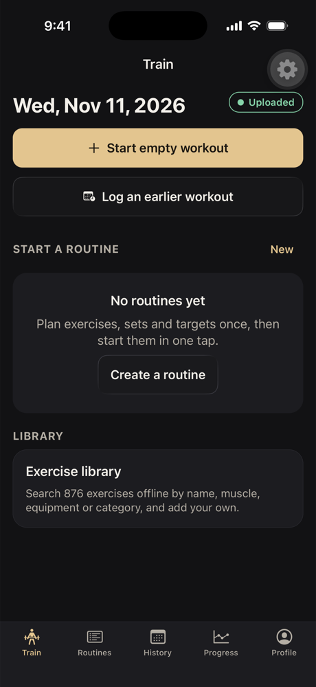 Train tab, cloud account | 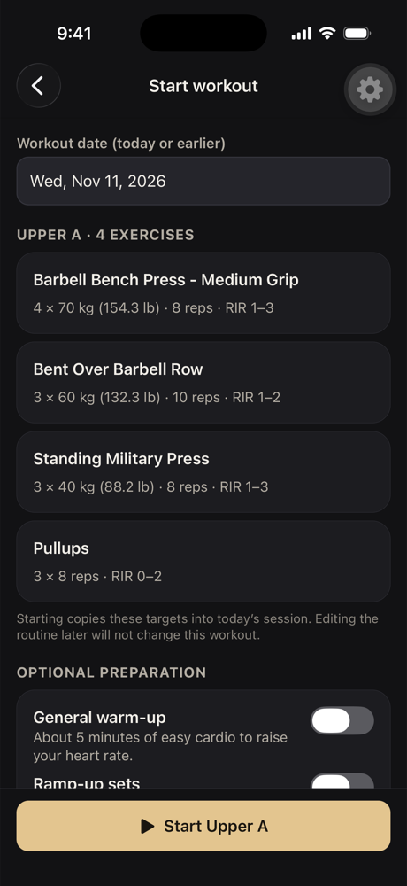 Routine start with targets | 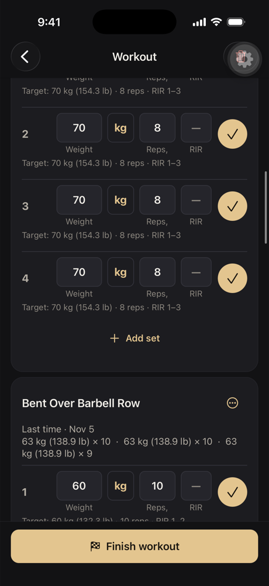 Inline set rows with previous performance |
| 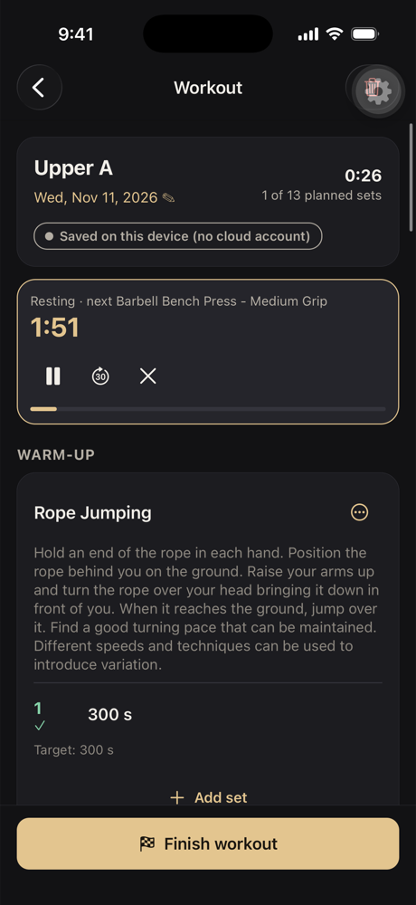 Rest countdown | 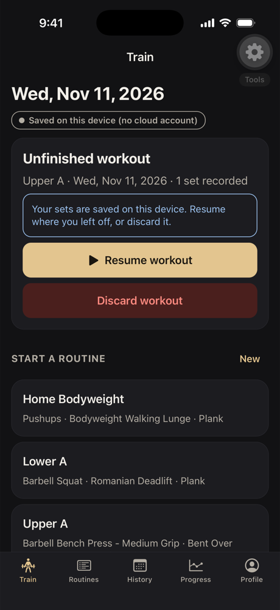 Resume after force-quit | 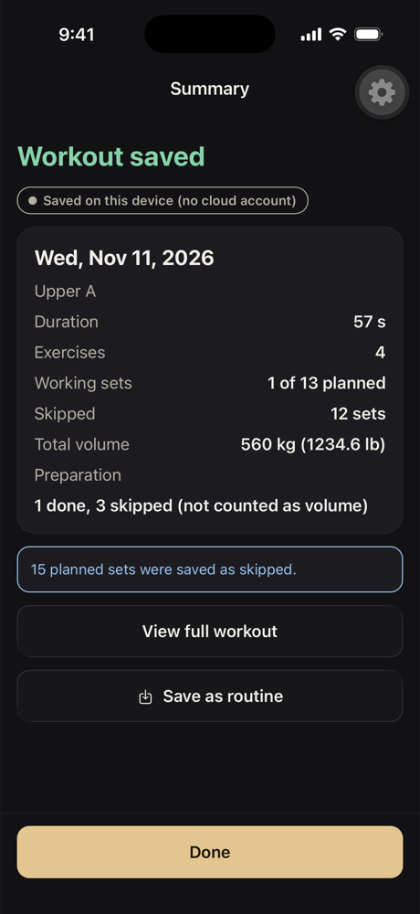 Finish summary |
| 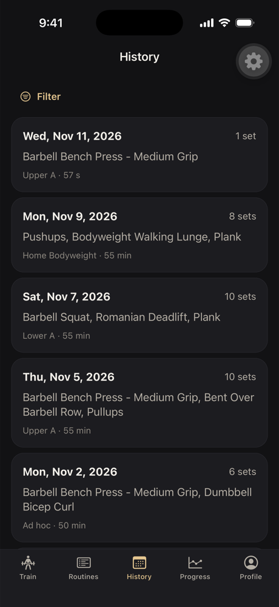 History | 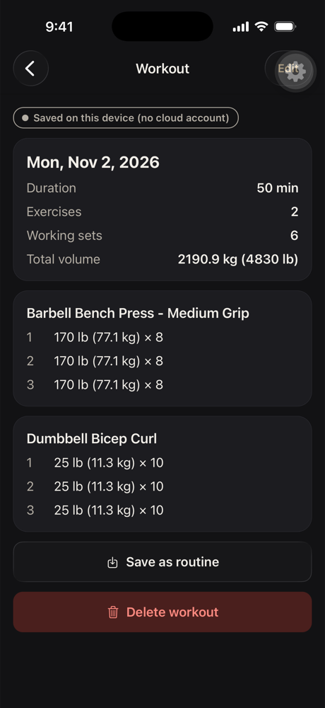 Workout entered in lb | 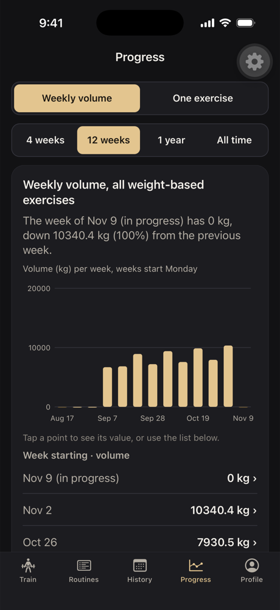 Weekly volume graph |
| 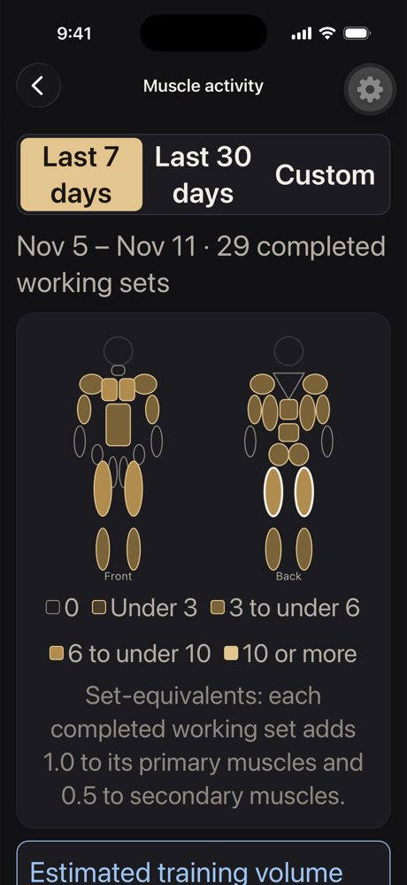 Muscle map at 200 % text | 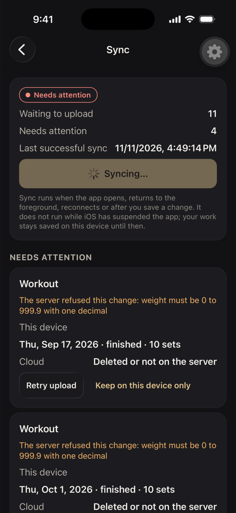 Server-refused change shown for review | |

## Student feedback that started One Shot 2

The interface feels too zoomed in and not premium; the app feels laggy. The muscle diagram should be a realistic body figure (not shapes), with a male/female choice. Each exercise should show how to perform it correctly (video or text). See [One Shot 2](../../round-02/claude/README.md).
