# Claude One Shot 2 — Repwise redesign

- **Date:** November 11, 2026. Claude Code session continuing from One Shot 1 (Claude Opus 5.5, model id `claude-opus-5-5`).
- **Input:** the student's feedback on One Shot 1 (below). The One Shot 1 app is preserved as git tag `claude-one-shot-1` with screenshots in [round-01/claude](../../round-01/claude/README.md). `apps/chatgpt` was not opened.
- **Design update first:** [ROUND_02_CLAUDE.md](../../../design/ROUND_02_CLAUDE.md) adds UI-04, UI-05, TR-07A and TR-06A with acceptance checks. The navigation, data-model, training-data, presentation-class and catalog/muscle sequence diagrams were updated, plus TRACEABILITY, the diagram index and the design check (`scripts/check_design.py` passes).
- **Output:** [apps/claude](../../../../../apps/claude/README.md) on branch `claude/one-shot-2`. Evidence per requirement: [REQUIREMENTS.md](../../../../../apps/claude/REQUIREMENTS.md).

## Student feedback that drove this round

> The app is too zoomed in, it doesn't feel premium … For the diagram of the body … I want an actual body looking thing, not the shapes of the muscles … a way of selecting either male or female and a way of seeing how to perform an exercise, either a video or text of the correct form … And the app feels laggy.

## What changed

| Feedback | Change |
| --- | --- |
| Too zoomed in, not premium | Compact iOS type scale (body 15 pt, secondary 13 pt, captions 11.5 pt) with tabular figures; native large-title headers; native iOS 26 tab bar (Liquid Glass, minimizes on scroll); grouped list rows; a compact set table (SET · PREVIOUS · KG · REPS · RIR · ✓) instead of tall cards. |
| Body diagram should look like a body | Anatomical front/back figure from `react-native-body-highlighter` (MIT) used for the muscle heat map, the Profile preview and "Muscles worked". |
| Male or female | Synced `body_figure` setting (SQLite migration v2, Supabase migration `20261111000500_body_figure.sql`), switchable in Settings, Profile, the muscle screen and the form guide. |
| How to perform an exercise | "How to perform" modal: the catalog's start and end photos crossfade in a loop with pause (starts paused under Reduce Motion), numbered steps that work offline, muscles worked on the figure, an offline fallback, and a "no demonstration" note for custom exercises. Reached from the library (ⓘ), the picker and the exercise menu during a workout. No licensed video source was available, so the photo loop is the demonstration. |
| Laggy | Root cause: every recorded set invalidated the finished-workout cache and reloaded every mounted tab, and every upload acknowledgement did the same. Now the repository emits scoped change events, screens reload only for the scopes they read and only while focused, and acknowledgements emit only `sync`. Search uses `useDeferredValue`. |

## Verification

- `tsc --noEmit` and ESLint clean. `npm test`: 44 passed (3 new round-2 repository tests: scoped events, ack emits only `sync`, body figure and media round-trip); 9 backend tests skipped without env vars.
- Backend suite 9/9 on the local stack and on the hosted `repwise-claude` project after migration `…000500` was pushed.
- Native development build on the iPhone 17 Pro simulator (iOS 26.5, device-only profile, demo data): Train, set table, recording a set (row updates in under 0.6 s and rest starts), discard confirmation, How to perform (photo loop, steps, male and female figures), female muscle heat map with a selected region, History, Exercise library, Routines and Progress.
- Found and fixed during the check: elapsed time showed "234:53" (now `h:mm:ss`); rest controls wrapped onto two lines; the blurred header drew a grey band (now solid); History's large title was invisible with a `FlatList` (History now uses the standard scroll screen with a "Show older workouts" button for keyset paging).
- **Not verified:** 200 % text after the redesign; the form guide's offline fallback with the network off; physical-device Live Activity (unchanged from One Shot 1).

## Screenshots (iPhone 17 Pro simulator, iOS 26.5, demo data)

| | | |
| --- | --- | --- |
| 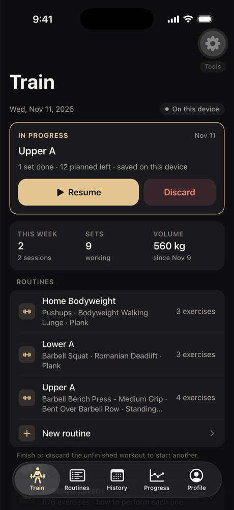 Train | 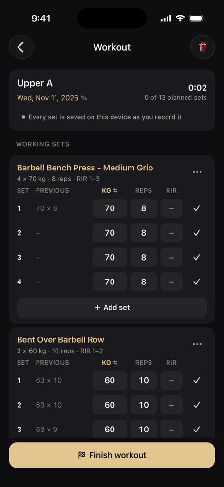 Compact set table | 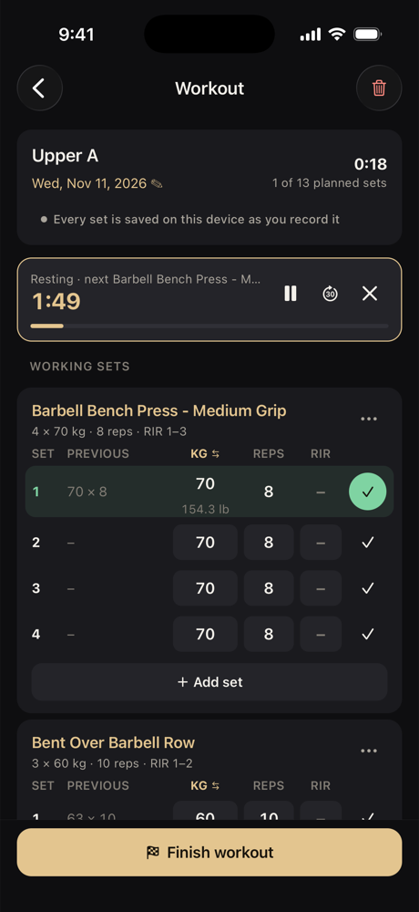 Set recorded, rest running |
| 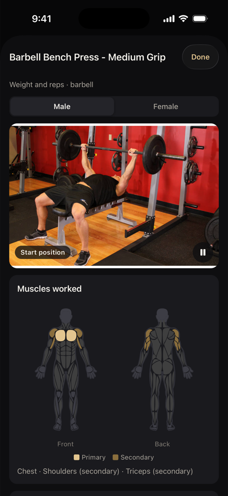 How to perform (male) | 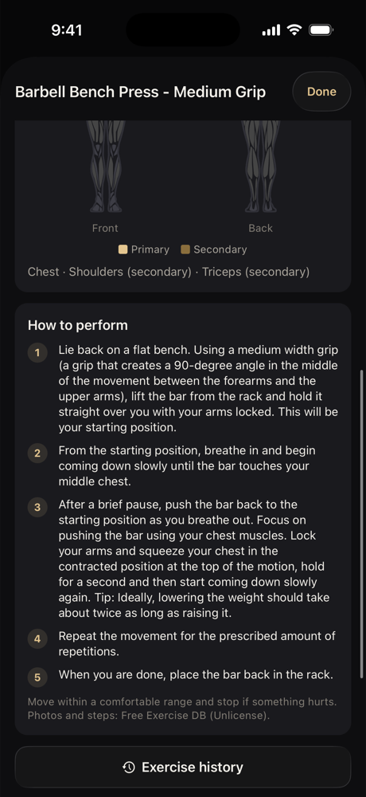 Numbered steps | 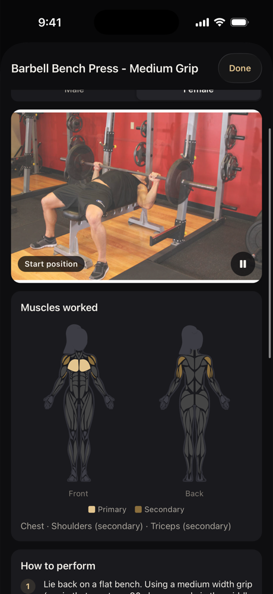 Female figure |
| 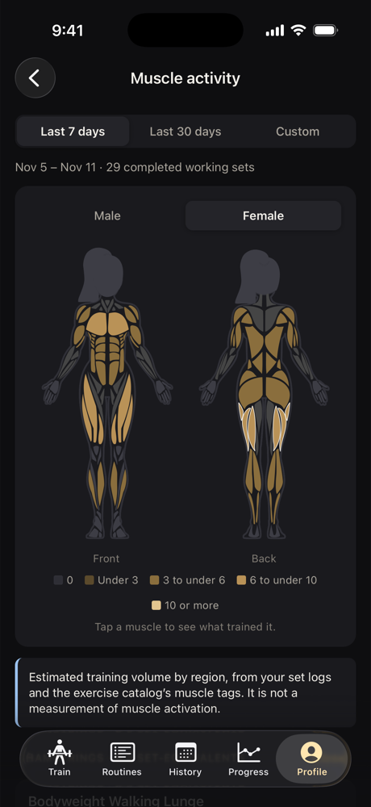 Muscle heat map | 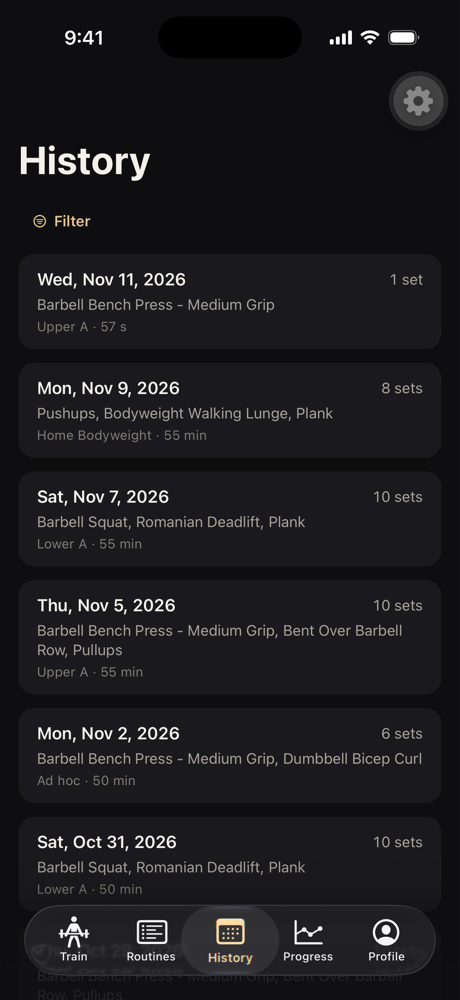 History | 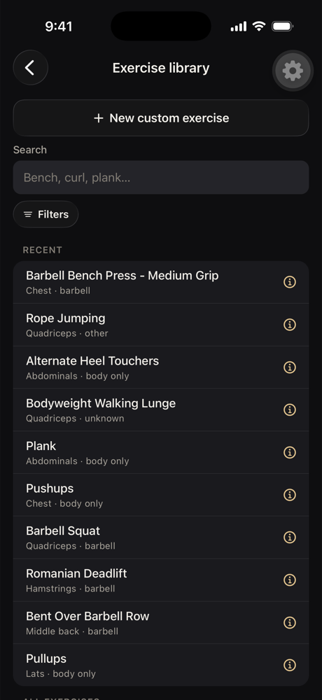 Exercise library |
| 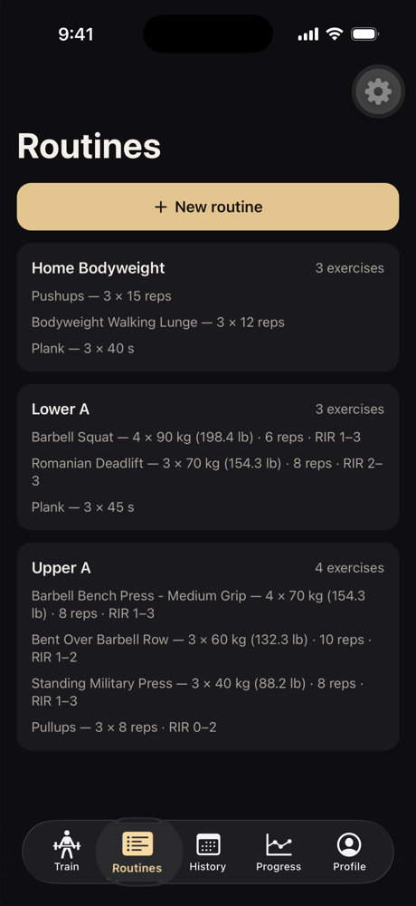 Routines | 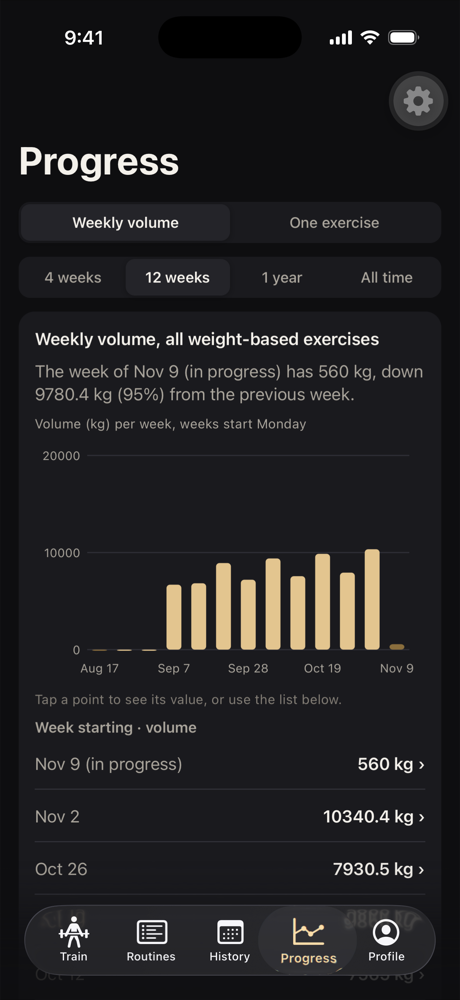 Weekly volume | |

## Release

A new native module (`expo-image`) means One Shot 2 needs a new EAS build; an over-the-air update is not enough. Build and submit from `apps/claude` with `npx eas-cli@latest build --platform ios --profile production --auto-submit`.
